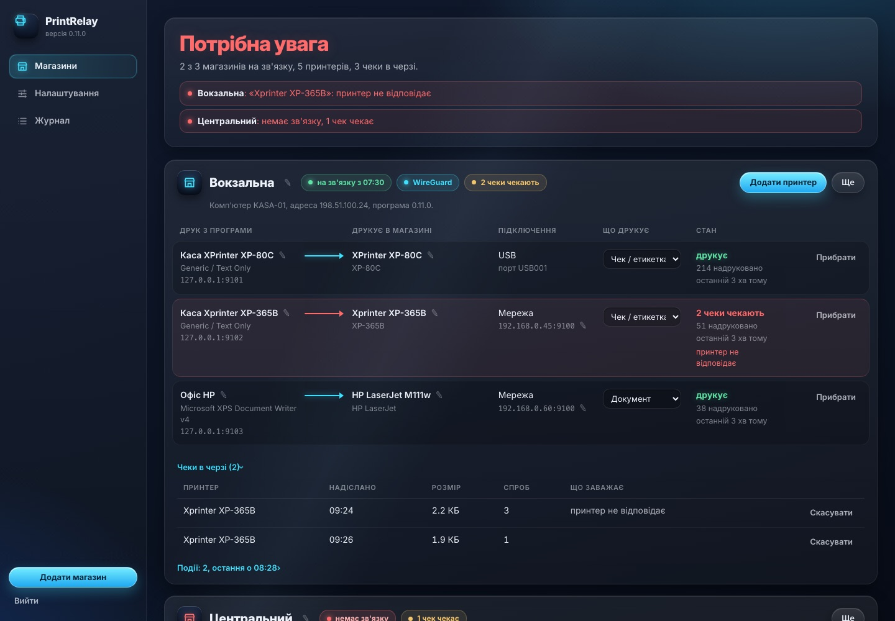

# SlipDrukka

Print from programs on a Windows Server to printers in shops over the
internet. No port forwarding at the shops, no printer driver needed there,
and receipts that were sent while a shop was offline print as soon as it is
back.

[Українська](README.uk.md) · [Wiki](docs/README.md)



```
Windows Server                                   Shop (Windows 10/11)
  program (accounting, POS…)                       slipdrukka-agent (service)
    → Windows printer with the model driver          → Windows printer
    → port 127.0.0.1:91xx                            → USB or network
    → slipdrukka-server (service)  ◄── tunnel ────   the shop dials in itself
```

## Why

Programs that run on a terminal server print to printers in many shops.
The usual answers are VPNs to every shop, forwarded ports, or drivers for
every receipt printer installed on every till. SlipDrukka replaces all of
that with one small service on the server and one at each shop.

## What it does

* **The receipt is rendered on the server.** The model's driver on the server
  draws the receipt, QR codes and barcodes; the shop gets the ready bytes and
  prints them unchanged. "Generic / Text Only" is enough at the shop.
  Printers that need their own driver on site (some laser printers) use the
  **Document** mode: the shop prints an XPS document with its own driver.
* **The shop connects to the server**, so nothing is set up on shop routers.
  The server needs one forwarded port.
* **Nothing is lost.** Every job is written to the server's disk before
  Windows hears "sent", delivered in order, and removed only after the shop
  confirms printing. A job that is resent after a lost confirmation is not
  printed twice. Jobs older than a set time (60 minutes by default) are
  dropped, so yesterday's receipts do not come out in the morning.
* **One admin panel** on the server: add shops and printers (already in
  Windows, network by IP, USB with a test print), create the Windows printer
  on the server, rename printers on both sides, change a printer's IP, see
  queues and events. The shop page only shows the status.
* **Ukrainian and English.** Each panel has a UA / EN switch (the browser's
  language by default); log files use the language chosen in Settings.
* **Shops look after themselves.** The shop program notices printers renamed
  by Windows Update, new-type (v4) drivers that drop raw data, and printers
  that disappeared, and keeps printing through a service queue on the same
  port. The panel only reports it.

## Security

* **Encryption:** TLS; the shop checks the server certificate against the
  fingerprint in its connection code. Each shop has its own key; the server
  stores only a hash of it. A new code or deleting a shop revokes it at once.
* **WireGuard (optional, on by default):** built into both programs as a
  userspace stack — no adapter, no driver, no routes in Windows, other VPNs
  are not touched. The TLS connection runs inside the tunnel, and the server
  does not answer packets without a valid key. Shops where UDP is blocked fall
  back to plain TLS on their own.
* **Built-in ban:** 5 failed connections in 10 minutes block an address (for
  5 days by default). Shops' own addresses are never blocked, and a valid code
  lifts a block, so a shop with an old code is not cut off.
* **Limits** on connections that have not shown a code, an alert when a shop
  connects from a new address, optional tying of codes to addresses, codes
  that expire if unused.
* **Allow-list** of the shops' addresses for the port, if you want it.
* **CrowdSec (optional):** a log and ready-made rules for CrowdSec, and the
  server can refuse addresses CrowdSec has banned. See [crowdsec/](crowdsec/).
* **Panel:** sign-in with a Windows administrator account, accepted only on
  the server itself; an action log of who did what and from where.
* **Services without admin rights:** both services run under their own
  virtual accounts (`NT SERVICE\SlipDrukkaServer`, `NT SERVICE\SlipDrukkaAgent`).
  Local printer ports accept data only from the Windows print spooler.

## Install

Download the two installers from
[Releases](https://github.com/TrueNihilisme/SlipDrukka/releases):
`slipdrukka-server-X.Y.Z.msi` for the server, `slipdrukka-agent-X.Y.Z.msi`
for each shop. Double-click opens a setup wizard that says what it installs;
the shop installer asks for the connection code (it can also be entered
later). Every install and removal writes a log; the last window says where.
Removing via **Settings → Apps** takes back the service, its firewall rules
and its printing rights; settings stay in `%ProgramData%\SlipDrukka`.

For many shops, the same without windows:

```
msiexec /i slipdrukka-server-X.Y.Z.msi /qn /norestart
msiexec /i slipdrukka-agent-X.Y.Z.msi /qn /norestart CODE=SD1-…
```

1. Install the server package on the Windows Server. Forward port **7310**
   (TCP, and UDP for WireGuard) on the server's router.
2. Open the panel on the server: `http://127.0.0.1:7330`, sign in as a
   Windows administrator. In **Settings** enter the server's public address,
   for example `relay.example.com:7310`.
3. **Add shop** — the panel gives an install command with the shop's code.
   Run it on the shop computer as an administrator.
4. **Add printer** for the shop, then create the printer on the server.
   Print a test page.

The packages never restart the computer. The [wiki](docs/README.md) explains
every window with an example.

## Requirements

* Server: Windows Server (measured on 2019) or Windows 10/11.
* Shop: Windows 10/11.
* The model's driver for receipt printers installed on the server.

## Limits

* All queued jobs together: up to 4 GB.
* Printers that need two-way communication with their driver during
  printing may not work in the raw mode; use the Document mode for those.

## Ports

| What | Default | Where to change |
|---|---|---|
| Server: port for shops | TCP 7310, and UDP 7310 for WireGuard | panel → Settings |
| Server: admin panel | 127.0.0.1:7330 | panel → Settings (this computer only / local network) |
| Server: first port for new printers | 9101 (`127.0.0.1:91xx`) | panel → Settings |
| Shop: status page | 127.0.0.1:7320 | — |

A new port is opened first and only then the old one closed; connected shops
stay connected. The forwarding on the server's router is changed by hand.

## Commands

| | |
|---|---|
| `install` | install the service (as administrator) |
| `uninstall` | remove the service (settings stay) |
| `run` | run in a console window |
| `set-password [password]` | server: emergency panel password (none — generate one; `-` — remove) |
| `account limited` / `account system` | run the service under its own account without admin rights (the default) or as SYSTEM |
| `version` | version |

Settings, logs and keys: `%ProgramData%\SlipDrukka\server` or `…\agent`
(readable only by SYSTEM, administrators and the service itself).

## Build

```sh
./build.sh          # dist/: Windows x64 programs and MSI packages
go test ./...       # end-to-end tests: server ↔ shop on a fake spooler
```

Needs Go 1.27.3 or newer (the version in `go.mod`); the MSI packages need
`msitools` (`brew install msitools`). Every push is tested and built by
[GitHub Actions](.github/workflows/ci.yml); the packages of a release are
built there from its tag.

## Support

If this project is useful to you, you can support its development with a crypto donation:

| Network | Address |
|---|---|
| Bitcoin (BTC) | `bc1q0sw0w9mqtghrxfyyqw834sjs7t7rr7futulgv4` |
| Ethereum (ETH) | `0xAb3a04a4b52547a7f8B00abb0088D3d9d11CA461` |
| Solana (SOL) | `2QBoKrUaiAcAKxNJ7o9oe9Q16ptjLQohR8KyPX2tpJhZ` |

Send each coin only on the network named in its row: a transfer made on another network cannot be recovered.

## License

[GNU Affero General Public License v3.0](LICENSE). If you run a modified
SlipDrukka for others over a network, you must offer them its source code.

The Inter font is under the SIL Open Font License 1.1
([internal/common/fonts/Inter-LICENSE.txt](internal/common/fonts/Inter-LICENSE.txt)).
