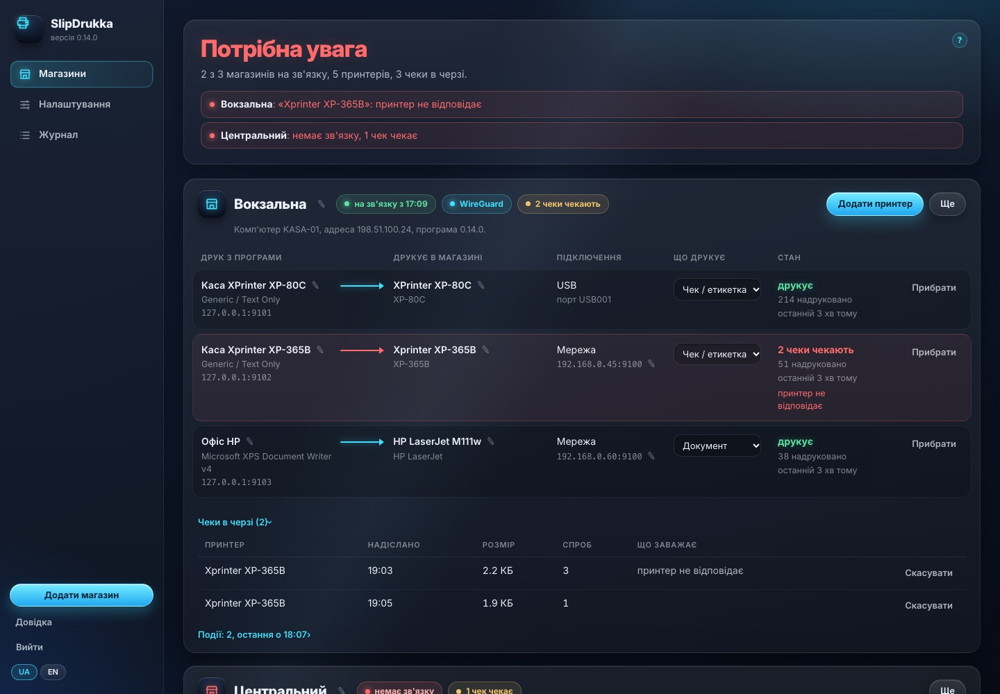
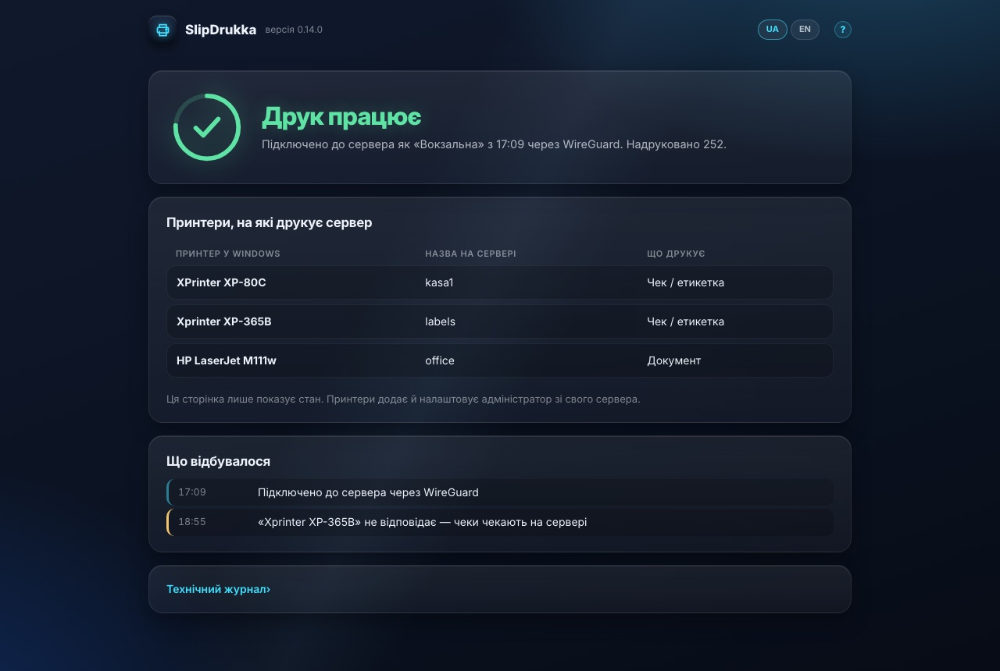

# SlipDrukka

Друк з програм на Windows Server на принтери в магазинах через інтернет.
Без проброса портів у магазинах, без драйвера принтера на місці, а чеки,
надіслані, поки магазин був без зв'язку, друкуються, щойно він повернеться.

[English](README.md) · [Вікі](docs/README.md)



```
Windows Server                                   Магазин (Windows 10/11)
  програма (облік, каса…)                          slipdrukka-agent (служба)
    → принтер Windows з драйвером моделі             → принтер Windows
    → порт 127.0.0.1:91xx                            → USB або мережа
    → slipdrukka-server (служба)  ◄── тунель ────    магазин сам підключається
```

## Знімки

| Налаштування | Сторінка магазину |
|---|---|
|  |  |

Більше, вікно за вікном, — у [вікі](docs/README.md). На знімках вигадані магазини.

## Навіщо

Програми на термінальному сервері друкують на принтери в багатьох магазинах.
Звичні рішення — VPN до кожного магазину, проброшені порти або драйвери
кожного чекового принтера на кожній касі. SlipDrukka замінює це однією
невеликою службою на сервері й однією в кожному магазині.

## Що вміє

* **Чек малює сервер.** Драйвер моделі на сервері малює чек, QR-коди й
  штрихкоди; магазин отримує готові байти і друкує їх без змін. У магазині
  досить «Generic / Text Only». Принтери, яким потрібен свій драйвер на місці
  (частина лазерних), працюють у режимі **«Документ»**: магазин друкує
  документ XPS своїм драйвером.
* **Магазин сам підключається до сервера**, тож на роутерах магазинів нічого
  не налаштовується. На сервері прокидається один порт.
* **Нічого не губиться.** Кожне завдання спершу записується на диск сервера,
  і лише тоді Windows чує «надіслано»; доставляється по черзі й видаляється
  лише після підтвердження від магазину. Повторно надіслане після втраченого
  підтвердження вдруге не друкується. Завдання, старші за заданий строк
  (за замовчуванням 60 хвилин), прибираються, щоб зранку не вийшли вчорашні
  чеки.
* **Одна панель** на сервері: додати магазин і принтери (уже є у Windows,
  мережевий за IP, USB з тестовим друком), створити принтер Windows на
  сервері, перейменувати принтери з обох боків, змінити IP принтера, бачити
  черги й події. Сторінка магазину лише показує стан.
* **Українська й англійська.** У кожній панелі перемикач UA / EN (за
  замовчуванням — мова браузера); журнали пишуться мовою з налаштувань.
* **Магазин дає собі раду сам**: помічає принтери, перейменовані Windows
  Update, драйвери нового типу (v4), які гублять чеки, і зниклі принтери, і
  далі друкує через службову чергу на тому ж порту. Панель лише повідомляє.

## Безпека

Що відкрито, що захищає, чого ні і як повідомити про вразливість: [SECURITY.md](SECURITY.md) (англійською).

* **Шифрування:** TLS; магазин звіряє сертифікат сервера з відбитком у своєму
  коді підключення. Код діє один раз: під час першого підключення магазин
  отримує власний ключ, сервер зберігає лише його хеш. Новий код або
  видалення магазину одразу його відкликають.
* **WireGuard (необов'язково, за замовчуванням увімкнено):** вбудований в
  обидві програми — без адаптера, драйвера і маршрутів у Windows, інші VPN не
  зачіпаються. Усередині тунелю йде те саме з'єднання TLS, а на пакети без
  правильного ключа сервер не відповідає. Магазини, де UDP заблоковано, самі
  підключаються звичайним способом.
* **Вбудований бан:** 5 невдалих підключень за 10 хвилин блокують адресу (за
  замовчуванням на 5 днів). Адреси магазинів не блокуються ніколи, а дійсний
  код знімає блок, тож магазин зі старим кодом не відріжеться.
* **Ліміти** на з'єднання, що ще не показали код; попередження, коли магазин
  підключився з нової адреси; прив'язка кодів до адрес; невикористані коди
  старіють.
* **Список дозволених адрес** магазинів для порту — за бажанням.
* **CrowdSec (необов'язково):** журнал і готові правила для CrowdSec, а сервер
  може не пускати адреси, які CrowdSec заблокував. Див. [crowdsec/](crowdsec/).
* **Панель:** вхід обліковим записом адміністратора Windows, лише на самому
  сервері (`127.0.0.1`); 5 невдалих спроб за 5 хв блокують вхід, кожне
  наступне блокування вдвічі довше (до 15 хв), окремо для кожного сеансу
  Windows. Журнал дій: хто, що і звідки змінював. Аварійний пароль
  (`set-password`) — на випадок, коли вхід Windows недоступний.
* Обидві сторінки відкриваються лише за IP-адресою, через `localhost` або за
  ім'ям самого комп'ютера — захист від атаки DNS rebinding.
* **Служби без прав адміністратора** (див. «Права служб»). Локальні порти
  принтерів приймають дані лише від диспетчера друку Windows.

## Встановлення

Завантажте два інсталятори з
[Releases](https://github.com/TrueNihilisme/SlipDrukka/releases):
`slipdrukka-server-X.Y.Z.msi` для сервера, `slipdrukka-agent-X.Y.Z.msi` для
кожного магазину. Подвійний клік відкриває майстер, який пише, що саме
ставиться; інсталятор магазину питає код підключення (його можна ввести й
пізніше). Кожне встановлення й видалення пише журнал, останнє вікно каже де.
Видалення через **Параметри → Програми** забирає службу, її правила
брандмауера й права на друк; налаштування лишаються в `%ProgramData%\SlipDrukka`.

Для багатьох магазинів — те саме без вікон:

```
msiexec /i slipdrukka-server-X.Y.Z.msi /qn /norestart
msiexec /i slipdrukka-agent-X.Y.Z.msi /qn /norestart CODE=SD1-…
```

1. Встановіть пакет сервера на Windows Server. Прокиньте на роутері сервера
   порт **7310** (TCP, і UDP для WireGuard).
2. Відкрийте панель на сервері: `http://127.0.0.1:7330`, увійдіть
   адміністратором Windows. У **Налаштуваннях** вкажіть зовнішню адресу
   сервера, наприклад `relay.example.com:7310`.
3. **Додати магазин** — панель дасть команду встановлення з кодом магазину.
   Виконайте її на комп'ютері магазину від адміністратора.
4. **Додати принтер** магазину, потім створіть принтер на сервері.
   Надрукуйте тестову сторінку.

* Пакети **ніколи не перезавантажують комп'ютер** (`REBOOT=ReallySuppress`);
  `/norestart` — для певності.
* Код із `CODE=…` установник кладе в розділ реєстру, закритий для всіх, крім
  SYSTEM і адміністраторів; служба забирає його при першому запуску й
  видаляє. У докладному журналі установника (`/l*v`) код видно, тож такий
  журнал не лишайте в загальнодоступній теці.
* Нова версія ставиться поверх старої, налаштування зберігаються. Щоб при
  видаленні прибрати ще й правила брандмауера та права служби на принтери,
  спершу виконайте `slipdrukka-server.exe uninstall` (на точці —
  `SlipDrukka-service.exe uninstall`).

Кожне вікно з прикладом пояснює [вікі](docs/README.md).

### Перевірити завантажений файл

Від 0.18.0 поруч із кожним інсталятором у релізі лежить підпис Sigstore
(`….msi.sigstore.json`). Він доводить, що файл зібрано release-процесом
цього репозиторію з тега. З установленим
[cosign](https://docs.sigstore.dev/):

```
cosign verify-blob slipdrukka-server-X.Y.Z.msi \
  --bundle slipdrukka-server-X.Y.Z.msi.sigstore.json \
  --certificate-oidc-issuer https://token.actions.githubusercontent.com \
  --certificate-identity-regexp '^https://github.com/TrueNihilisme/SlipDrukka/\.github/workflows/ci\.yml@refs/tags/v'
```

Це не підпис Windows: Windows і далі показує «Невідомий видавець».

## Вимоги

* Сервер: Windows Server (виміряно на 2019) або Windows 10/11.
* Магазин: Windows 10/11.
* Драйвер моделі для чекових принтерів — на сервері.

## Керування точками (панель сервера)

Кожна точка — окрема таблиця: **принтер на сервері → принтер у магазині**.
Обидві назви можна змінити (✏️), точку теж можна перейменувати.

* **+ Додати принтер** у картці точки:
  * вже встановлений у Windows точки — просто видати на сервер;
  * мережевий (IP і порт, зазвичай 9100) — програма створить на точці порт
    Standard TCP/IP (RAW) і принтер Windows;
  * USB — вибрати порт (`USB001`…); кнопка «Тест» друкує на порт короткий
    текст, щоб у магазині було видно, який принтер на якому порту.
  Драйвер на точці за замовчуванням — вбудований «Generic / Text Only».
* **Створити принтер** біля принтера точки — на сервері: виберіть драйвер
  моделі (його треба встановити на сервері заздалегідь) і назву. Буде створено
  порт `SLIPDRUKKA_91xx` (127.0.0.1:91xx, RAW) і принтер Windows на ньому.
* Порт `91xx` закріплюється за принтером точки: якщо принтер прибрати й
  видати знову, порт той самий і черги Windows на сервері не ламаються.
  Непотрібний порт звільняє кнопка «Звільнити порт» у рядку «не видано» —
  лише коли жоден принтер Windows на сервері вже не дивиться на цей порт.
* Одна точка може видати до 64 принтерів і тримати до 64 портів.
* Порти `127.0.0.1:91xx` приймають дані лише від диспетчера друку Windows
  (служби в сеансі 0). Програма користувача, яка підключиться до порту
  напряму, оминаючи принтер Windows, отримає відмову: хто може друкувати на
  принтер магазину, визначають дозволи самого принтера Windows на сервері.

Що сервер може на комп'ютері магазину, обмежено самою точкою:

* перейменувати принтер, змінити його драйвер чи IP-адресу можна лише для
  принтера, який видано на сервер або який створила сама програма. Решта
  принтерів магазину для сервера недоступна;
* адреса мережевого принтера — лише з локальної мережі магазину (10.x,
  172.16–31.x, 192.168.x, локальне ім'я). Адресу в інтернеті точка відхилить;
* сторінка точки відкривається лише на самому комп'ютері магазину.

### Точка працює сама

Поставив — і в панель заходиш лише по новий принтер чи нову IP-адресу.
Точка кожні 15 с звіряє видані принтери з Windows і сама дає раду змінам,
а в панель лише повідомляє:

* **перейменовано** — Windows Update поставив інший драйвер і змінив назву
  (напр. `XP-420B` → `XP-420BM`). Якщо на тому самому порту рівно один
  невиданий принтер, точка сама переходить на нього;
* **драйвер v4** у режимі «чек / етикетка» (деякі такі драйвери мовчки
  гублять чеки, див. «Обмеження») — точка друкує через **службову чергу**
  «SlipDrukka (назва)» з драйвером «Generic / Text Only» на тому самому
  порту. Принтер магазину не чіпається: якщо продавці друкують на ньому
  самі, у них нічого не зміниться;
* **принтер зник** з Windows (видалили, кілька принтерів на порту після
  оновлення) — так само через службову чергу на запам'ятованому порту;
* коли принтер магазину знову придатний, службова черга прибирається сама.

Для режиму «документ» потрібен рідний драйвер принтера, тож якщо такий
принтер зник, документи чекають у черзі сервера, а в панелі — помилка.

**З панелі за потреби:** ✏️ біля IP-адреси — нова адреса мережевого
принтера (назва й порт на сервері ті самі, програми нічого не помічають);
«змінити драйвер» біля принтера з v4 — поставити йому «Generic / Text Only»,
щоб службова черга була не потрібна.

## Права служб

Обидві служби працюють не від імені системи (SYSTEM), а кожна під власним
обліковим записом Windows: `NT SERVICE\SlipDrukkaServer` і
`NT SERVICE\SlipDrukkaAgent`. Такий запис Windows створює сама, пароля в нього
немає, до групи адміністраторів він не входить.

Як це відбувається: установник реєструє службу як SYSTEM. При першому запуску
(і після кожного оновлення) служба, поки має ці права:

* закриває теку даних: власник — «Адміністратори», доступ лише в SYSTEM,
  адміністраторів і самої служби. Теку, яку заздалегідь створив не
  адміністратор, відкладає вбік (`….foreign-дата`) і починає з порожньої;
* дає своєму запису права керувати принтерами: «Manage Server» на сервері
  друку цього комп'ютера і керування наявними та майбутніми принтерами. Прав
  змінювати дозволи самого сервера друку немає;
* сервер: створює правила брандмауера для своєї програми (TCP і UDP); точка: ставить
  вбудований драйвер «Generic / Text Only»;
* лишає в токені служби один привілей (`SeChangeNotifyPrivilege`), перемикає
  службу на власний запис і перезапускає її. Це кілька секунд. Поки служба
  ще SYSTEM, вона не відкриває жодного порту й ні до чого не підключається
  (від 0.18.0): це робить уже перезапущена служба під власним записом.

Якщо щось із цього не вдалося, служба працює далі як SYSTEM і пише причину в
журнал: друк через це не зупиняється. Її сторінка при цьому показує
попередження, доки причину не усунуть.

Що з цього випливає:

* служба не може змінювати правила брандмауера. Тому правила стосуються
  програми, а не порту: «SlipDrukka Server» (TCP) і «SlipDrukka Server
  WireGuard» (UDP). Порт для точок можна міняти в панелі без них. Список
  дозволених адрес перевіряє сама програма;
* драйвер моделі на сервер ставить адміністратор, як і раніше.

Повернути службу під SYSTEM (якщо на якомусь комп'ютері власного запису
виявилось замало): `slipdrukka-server.exe account system`, назад —
`account limited`. Те саме для `SlipDrukka-service.exe`. У режимі `system`
сервер, як у старих версіях, сам переписує правило брандмауера на порт точок
зі списком дозволених адрес.

Виміряно на Windows 11 і Windows Server 2019 (служби під власними записами):
друк чеків, створення, перейменування й зміна адреси принтерів, відмова на
хибний пароль Windows у панелі і успішний вхід адміністратором Windows (на
Windows Server 2019); на Windows 11 ще й друк документів і зміна порту.

## Режими принтера

Режим вибирається в панелі сервера для кожного принтера точки.

| | Чек / етикетка | Документ |
|---|---|---|
| Для чого | чеки, етикетки (Xprinter, Zebra, Gprinter…) | принтери, яким потрібен свій драйвер на місці (HP 1018 з прошивкою, Canon CAPT…) |
| Драйвер на сервері | драйвер моделі (він малює чек, QR) | вбудований «Microsoft XPS Document Writer v4» |
| Драйвер на точці | будь-який (навіть «Generic / Text Only») | рідний драйвер принтера |
| Що йде тунелем | готові байти для принтера, без змін | документ XPS |

У режимі «документ» сервер надсилає документ (Windows видає його у форматі
OpenXPS), агент перетворює його у звичайний XPS засобами Windows
(XPS Document API) і друкує через `PrintQueue.AddJob` — тобто рідним
драйвером принтера на точці. Формат паперу й орієнтація (А4, альбомна тощо)
задаються в діалозі друку на сервері як завжди й доходять до точки.
Кнопка «Створити принтер» у панелі сервера для такого принтера сама підставляє
XPS Writer; користувачі бачать лише назву принтера.

## Порти

| Що | За замовчуванням | Де змінити |
|---|---|---|
| Сервер: порт для точок | TCP 7310 і UDP 7310 для WireGuard (усі адреси) | панель сервера → «Налаштування» |
| Сервер: панель | 127.0.0.1:7330 | панель сервера → «Налаштування» (лише цей ПК / локальна мережа) |
| Сервер: перший порт для нових принтерів | 9101 | панель сервера → «Налаштування» |
| Точка: сторінка стану | 127.0.0.1:7320 | — |

* Новий порт спершу відкривається, і лише тоді закривається старий; якщо
  порт зайнятий — нічого не змінюється.
* Правила брандмауера Windows стосуються програми, а не порту, тож їх
  міняти не треба. Перенаправлення на роутері сервера треба змінити вручну.
* Уже підключені точки після зміни порту лишаються на зв'язку. Код містить
  зовнішню адресу: якщо змінилась і вона — видайте точкам нові коди.
* Значок біля годинника дізнається адресу панелі з реєстру
  (`HKLM\Software\SlipDrukka\AgentPanelURL`).

## Команди

| | |
|---|---|
| `install` | встановити службу (від адміністратора) |
| `uninstall` | видалити службу (налаштування лишаються) |
| `run` | запустити у вікні консолі |
| `set-password [пароль]` | сервер: аварійний пароль панелі (без аргументу — згенерувати; `-` — прибрати); служба перезапускається сама |
| `account limited` / `account system` | від чийого імені працює служба: власний запис без прав адміністратора (так і є після встановлення) або SYSTEM |
| `version` | версія |

Налаштування, журнал і ключі: `%ProgramData%\SlipDrukka\server` або `…\agent`
(доступ лише в SYSTEM, адміністраторів і самої служби).

## Збірка

```sh
./build.sh          # dist/*.exe для Windows x64, потрібен Go
go test ./...       # наскрізний тест сервер↔агент на фейковому спулері
```

Потрібен Go 1.27.4 або новіший (версія з `go.mod`); для пакетів MSI —
`msitools` (`brew install msitools`). Кожен push перевіряє і збирає
[GitHub Actions](.github/workflows/ci.yml); пакети релізу збираються там із
його тегу.

## Обмеження

* Усі завдання в черзі сервера разом — до 4 ГБ. Коли черга повна, нові
  завдання сервер не приймає (Windows тримає їх у своїй черзі й повторює),
  доки не доставить або не прибере за строком ті, що чекають.

* **Драйвери v4 у режимі «чек / етикетка».** Виміряно: через драйвери v3
  (Xprinter XP-420B, «Generic / Text Only») і «Microsoft XPS Document Writer v4»
  готові дані доходять без змін, а через «Microsoft IPP Class Driver» і
  «Microsoft Print To PDF» (обидва v4) до принтера не дійшло нічого, хоча
  Windows звітувала «надруковано». Тому чеки на принтер із драйвером v4, якого
  немає серед перевірених, точка друкує через службову чергу «Generic / Text
  Only» на тому ж порту (див. «Точка працює сама»).
* Принтери, яким драйвер шле прошивку або з якими веде двосторонній обмін
  під час друку (напр. частина «host-based» лазерних), через RAW можуть не
  працювати. Для них потрібен режим «USB через мережу» — у планах.

## Підтримати

Якщо проєкт вам корисний, можна підтримати розробку криптовалютою:

| Мережа | Адреса |
|---|---|
| Bitcoin (BTC) | `bc1q0sw0w9mqtghrxfyyqw834sjs7t7rr7futulgv4` |
| Ethereum (ETH) | `0xAb3a04a4b52547a7f8B00abb0088D3d9d11CA461` |
| Solana (SOL) | `2QBoKrUaiAcAKxNJ7o9oe9Q16ptjLQohR8KyPX2tpJhZ` |

Надсилайте кожну монету лише в мережі, названій у її рядку: переказ в іншій мережі не повернути.

## Ліцензія

[GNU Affero General Public License v3.0](LICENSE). Якщо ви запускаєте
змінений SlipDrukka для інших через мережу, маєте надати їм його вихідний код.

Шрифт Inter — під SIL Open Font License 1.1
([internal/common/fonts/Inter-LICENSE.txt](internal/common/fonts/Inter-LICENSE.txt)).
