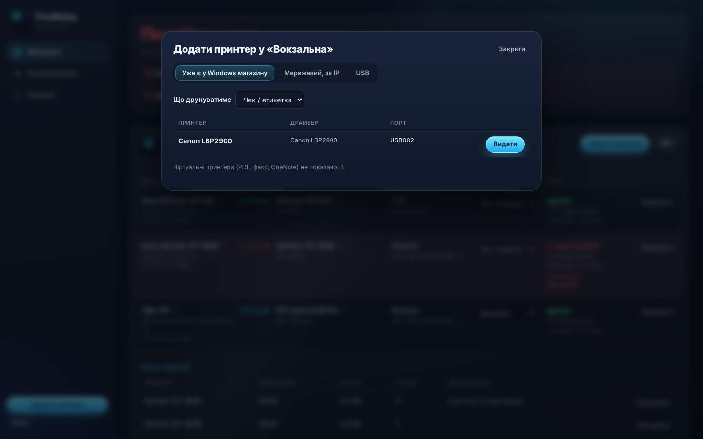
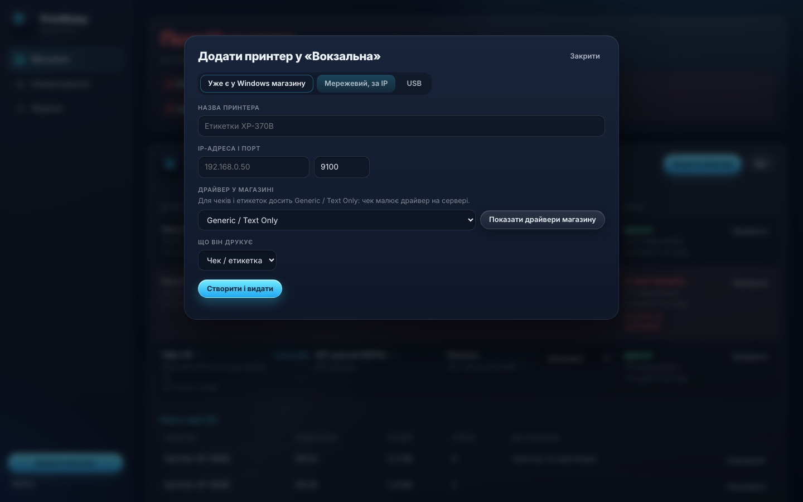
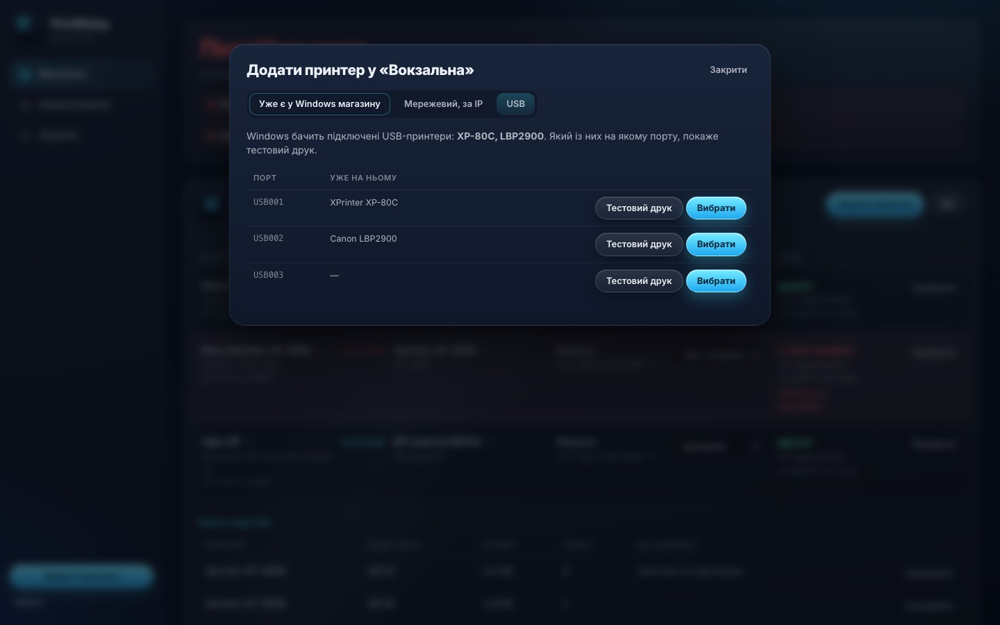

# Add a printer

[Українська](../uk/add-printer.md) · [All pages](../README.md)

## What it is for

Shares a printer of the shop with the server. The "Add printer" button is on
the shop card while the shop is connected. The shop program does all the
work — nobody has to go there or log on to that computer.

After "Share" or "Create and share" the panel opens
[Printer on the server](server-printer.md) right away: without it, programs
on the server have nothing to print to.

Every tab has **"What it will print"**: "Receipt / label" or "Document" (the
difference is explained on [Shops](shops.md#receipt--label-or-document)).

## Tab "Already in the shop's Windows"

The shop's Windows printers that are not shared yet. Virtual ones (PDF, fax,
OneNote) are hidden; their number is under the table. Columns: name, driver
(marked v4 for new-type drivers), port.

**Example.** The stall already has a Canon LBP2900 on USB002. Choose
"Document" (the Canon needs its own driver) → "Share".

## Tab "Network, by IP"

Creates a Standard TCP/IP port and a Windows printer on it in the shop.

* **Printer name** — what it will be called in the shop's Windows.
* **IP address and port** — the printer's address on the shop's local
  network, usually port 9100. The shop program refuses internet addresses.
* **Driver in the shop** — "Generic / Text Only" is enough for receipts and
  labels. "Show the shop's drivers" lists the drivers already installed on
  that computer.

**Example.** An Xprinter XP-370B label printer is on the shop network at
`192.168.0.50`. Name "Labels XP-370B", address `192.168.0.50`, port `9100`,
driver "Generic / Text Only", "Receipt / label" → "Create and share".

## Tab "USB"

The USB printer ports (`USB001`, `USB002`…) and what is already on each. If
Windows knows the models of connected printers, they are listed at the top.

* **Test print** — prints a short text to that port, so the shop can see
  which printer sits on which port.
* **Choose** — opens a form: name and what it will print. The printer is
  created with the "Generic / Text Only" driver.

**Example.** A new receipt printer was plugged into the till, but nobody
knows its port. "Test print" next to USB003 — the clerk says the receipt
printer printed. "Choose" next to USB003 → name "Receipt till 2" → "Create
and share".

## What the shop program lets the server do

* Rename a printer, change its driver or IP address only for printers that
  are shared with the server or that the program created itself. The server
  does not touch other printers of the shop.
* Network printer addresses only from the local network (10.x, 172.16–31.x,
  192.168.x or a local name).
* One shop can share up to 64 printers.
