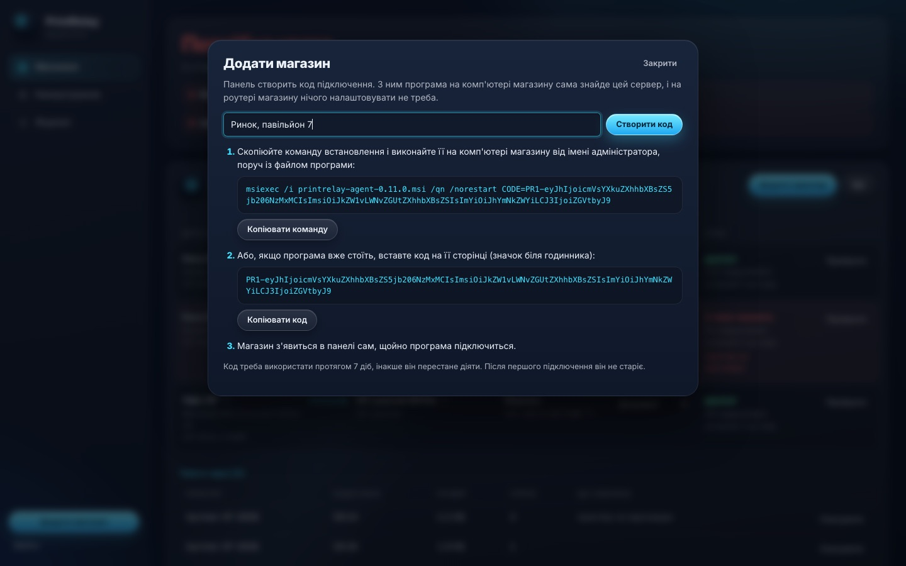

# Add a shop

[Українська](../uk/add-shop.md) · [All pages](../README.md)

## What it is for

Creates a new shop and its **connection code**. The code is all the shop
program needs to find the server and prove it is that shop.

## How it works

1. Enter a name (how the shop appears in the panel) and press "Create code".
2. The panel shows two options:
   * an **install command** — `msiexec … CODE=SD1-…`. Run it on the shop
     computer as an administrator, in the folder with
     `slipdrukka-agent-X.Y.Z.msi`. The program installs and connects right
     away;
   * the **code itself** — if the program is already installed (for example
     the shop moves to a new server), paste the code on its page.
3. As soon as the program connects, the shop appears in the panel as
   connected.

What the code holds: the server address, a random key for this shop only,
the fingerprint of the server certificate (so the shop never connects to a
fake server) and, when enabled, the server's WireGuard key. The server keeps
only a hash of the key.

**Validity.** The code must be used within the time set in
[Settings](settings.md#protection-against-guessing-and-scanners) (7 days by
default). Once the shop has connected, the code does not expire.

## Example

A new shop opens: "Market, stall 7".

1. "Add shop" → "Market, stall 7" → "Create code" → "Copy command".
2. On the stall's computer (over remote access) open a command prompt as
   administrator in the installer's folder and paste the command.
3. Within seconds the panel has a card "Market-stall-7" with a green
   "connected" badge. Next: [add a printer](add-printer.md).

## If it does not connect

* Check in [Settings](settings.md) that the public address is right and the
  port is forwarded on the server's router.
* The shop page (`http://127.0.0.1:7320`) shows the reason, for example
  "could not connect to relay.example.com:7310".
* "The connection code has expired" — issue a new one: "More → Issue a new
  connection code".
