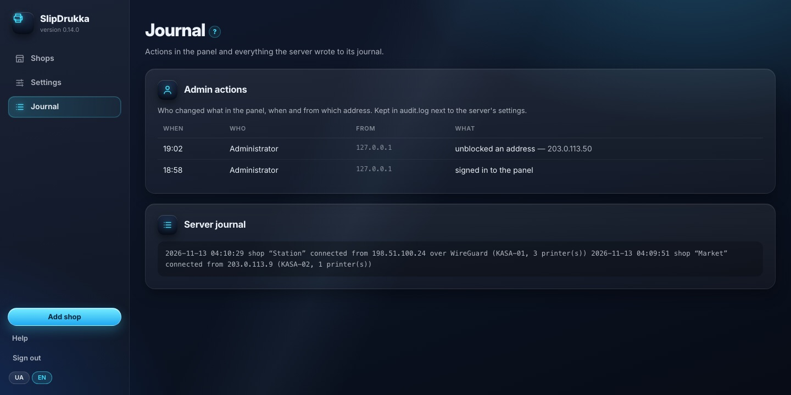

# Journal

[Українська](../uk/journal.md) · [All pages](../README.md)



## Admin actions

Who changed what in the panel, when and from which address: sign-ins (and
failed attempts), added and deleted shops, new codes, changes to address
lists, ports, WireGuard and protection, unblocks, renames, cancelled
receipts. Newest first.

Stored in `audit.log` in the server's settings folder
(`%ProgramData%\SlipDrukka\server`), one JSON line per action. When the file
grows past 1 MB it is moved to `audit.log.1` and a new one starts. The panel
shows the latest 100 entries.

**Example.** A shop suddenly went offline. The admin log shows: "07:42 —
Administrator, 127.0.0.1 — issued a new point code — Station". So someone
issued the shop a new code, and it has to be entered on that computer.

## Server journal

The technical log: shops connecting and disconnecting (and over which
channel), delivered receipts, refused and blocked addresses, errors. Newest
first. The full file is `server.log` in the same folder.

**Sample lines** (the log is in Ukrainian):

```
точка «Вокзальна» підключилась з 198.51.100.24:41000 через WireGuard (KASA-01, 3 принтер(и))
друк Вокзальна/kasa1 → «XPrinter XP-80C»: 812 байт надруковано (завдання 6ioRD3An89jX, у черзі 1s)
адресу 192.0.2.77 заблоковано до 18.11 03:37: 5 невдалих підключень за 10 хв (невідомий код підключення)
```

In order: a shop connected over WireGuard; a receipt printed; an address
blocked after five failed connections.
