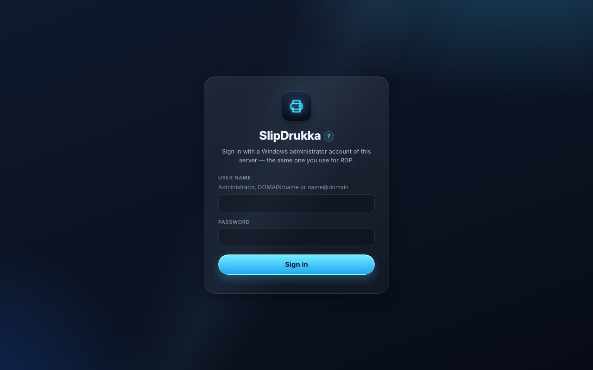

# Sign-in

[Українська](../uk/login.md) · [All pages](../README.md)

## What it is for

The server panel is password protected. You sign in with a **Windows
administrator account of this server** — the same one you use for RDP. There
are no separate SlipDrukka users.

## How it works

* **User name:** `Administrator`, `DOMAIN\name` or `name@domain`.
* Windows sign-in is accepted **only on the server itself** (`127.0.0.1`), so
  the password never travels over the network. If the panel is opened to the
  local network in settings, Windows sign-in from another computer fails.
* **Emergency password** — for when Windows sign-in is not available. Set it
  with `slipdrukka-server.exe set-password` on the server. To use it, leave
  the user name empty. The hint under the button appears only when such a
  password is set.
* **Guessing protection:** 5 failed attempts in 5 minutes block sign-in for
  a minute, each further block twice as long (up to 15 minutes). Attempts are
  counted per Windows session, so one user of a terminal server cannot lock
  the others out.
* Every sign-in and every failed attempt goes to the [Journal](journal.md):
  who, when and from where.

## Example

You are on the server over RDP as `Administrator`, open
`http://127.0.0.1:7330`, enter the same name and password, and the panel
opens. The admin actions log gets a line "signed in — Administrator,
127.0.0.1".

## If it does not let you in

* **"Windows sign-in only on the server itself"** — you opened the panel
  from another computer. Open it on the server or use the emergency password.
* **"Too many failed attempts — wait N s"** — wait that long.
* The account is not an administrator — use an administrator account or add
  it to the Administrators group.
