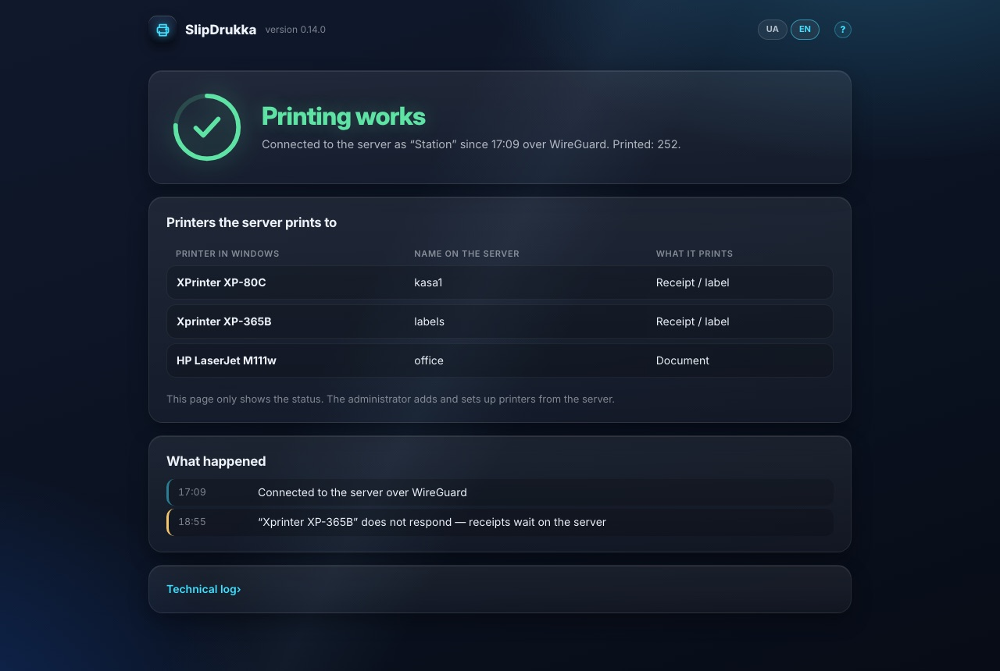

# Shop page

[Українська](../uk/point.md) · [All pages](../README.md)

## What it is for

The page of the program on the shop computer. Open it there:
`http://127.0.0.1:7320`, or the icon next to the clock → "Open panel".
**It only shows the status**: everything is managed from the server panel.
There is no password, because nothing can be changed here.

## What is on it

* **Status ring:**
  * green with a tick, **"Printing works"** — connected to the server; below:
    the shop's name on the server, since when, whether over WireGuard, how
    much has been printed;
  * red with a cross, **"No connection to the server"** — the program
    reconnects on its own as soon as the internet is back; receipts wait on
    the server meanwhile. The reason is shown below;
  * grey, **"Shop not connected yet"** — no code.
* **Connection to the server** — a field for the code. Shown only for a new
  shop, or when the server refused the old code (the shop was deleted or a new
  code issued). A working shop cannot be switched to another server from
  here.
* **Printers the server prints to** — the Windows printer, its name on the
  server, and what it prints.
* **What happened** — what the program noticed on its own: a printer
  renamed, a driver changed, a printer not responding, gone or back.
* **Technical log** — for support.

## Tabs

**State** — the main thing, **Events** — what happened, **Network** — this
computer's public address (as the server sees it), its addresses in the
shop network, the router, the server and the response time, plus a "Trace"
button for the route to the server. **Technical log** — for the
administrator.

## The shop program looks after itself

Every 15 seconds it checks the shared printers against Windows:

* Windows Update installed another driver and renamed the printer — if
  exactly one such printer sits on the same port, the program moves to it on
  its own;
* the printer has a new-type (v4) driver but prints receipts — the program
  prints through a service queue "SlipDrukka (name)" with the "Generic / Text
  Only" driver on the same port. The printer itself is left alone;
* the printer is gone — the same, through the service queue on the
  remembered port;
* once the printer is usable again, the service queue is removed on its own.

All of this shows up under "What happened" and in the server panel.

## Example

The clerk says "something does not print". Open the icon next to the clock on
the till: a red ring, "No connection to the server. Reason: could not connect
to relay.example.com:7310". So the shop has no internet — receipts wait on
the server and will come out on their own once it is back.
