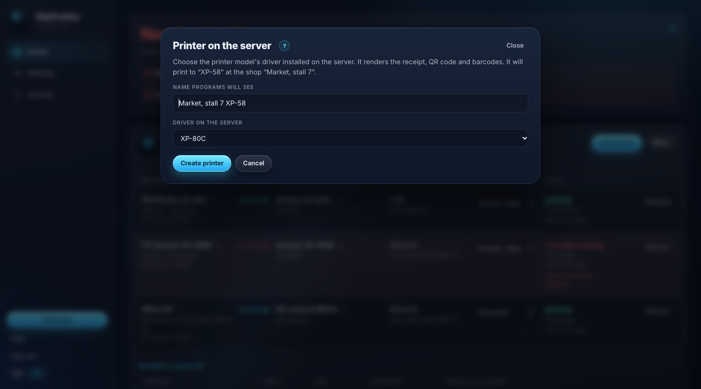

# Printer on the server

[Українська](../uk/server-printer.md) · [All pages](../README.md)

## What it is for

Programs on the server (accounting, POS) print to ordinary Windows printers.
This dialog creates such a printer on the server for each shop printer. It
opens on its own after a printer is added, or from the "Create printer on the
server" button in a table row.

## How it works

* **Name programs will see** — the one the cashier picks in the print
  dialog. Starting with the shop name helps: "Station Receipt", "Station
  Labels".
* **Driver on the server:**
  * for "Receipt / label" — the printer **model's** driver (XP-80C,
    ZDesigner…). It renders the receipt, QR code and barcodes, so it must be
    installed on the server beforehand. The list shows the drivers already on
    the server;
  * for "Document" — the built-in "Microsoft XPS Document Writer v4" is
    filled in; nothing to install.
* "Create printer" — the server gets a port `SLIPDRUKKA_91xx`
  (`127.0.0.1:91xx`) and a Windows printer on it.

The `91xx` port is tied to the shop printer: even if the printer is removed
and shared again, the number stays the same and the queues on the server keep
working.

One shop printer can have several printers on the server with different
drivers — they all print to the same printer in the shop. The next one is
added with "one more printer on the server" under those already there
(from 0.19.1; in older versions, in Windows on the server, on the same port
`SLIPDRUKKA_91xx`). This is how 2-in-1 printers
(receipt and label) are set up, see the README.

**Security:** ports `127.0.0.1:91xx` accept data only from the Windows print
spooler. A program that sends data to the port directly, bypassing the
Windows printer, is refused. Who may print is decided by the permissions of
the Windows printer on the server.

## Example

The stall's XP-58 receipt printer has been shared.

1. "Printer on the server" opens with the name filled in:
   "Market, stall 7 XP-58".
2. Driver on the server — "XP-58" (installed on the server earlier).
3. "Create printer". In the program on the server the cashier picks
   "Market, stall 7 XP-58" — and the receipt comes out at the stall.

## Paper size for everyone

A label printer's driver keeps the label size in the printing preferences,
and Windows stores those separately for every user. On a server many people
work on, each of them would have to set the size.

The **"paper size"** button under the printer's name on the server (for
"Receipt / label" mode) writes the size once for everyone:

1. Enter the width and height in millimetres, for example 40 and 25.
2. "Apply to everyone". "paper for everyone: 40 × 25 mm" appears under the
   printer's name.

From then on every user of the server who has not touched this printer's
preferences, and every new user, prints with this size.

**If someone still has the old size.** A user who saved preferences for this
printer earlier keeps printing with them: Windows keeps them in that user's
own registry. The same window has a ready command: run it in PowerShell as
an administrator on the server, and it removes the saved preferences of this
printer for every user, including those who are not signed in. It does not
touch other printers or other settings. The program does not do this itself:
its service runs without administrator rights.

Worth knowing:

* If the driver does not take the size, the panel says so and the settings
  stay as they were.
* The driver may print a little narrower than the size given. Measured with
  the Xprinter XP-420B driver: for a 40 × 25 mm label it sends the printer a
  width of 36 mm, because it keeps 2 mm clear on each side. It does the same
  when the size is set by hand.
* Only the paper size is written. Density, speed and the gap between labels
  are set in the printer's properties, as before.

## Notes

* ✎ next to the name renames the printer on the server. Programs remember
  printers by name, so after renaming it has to be picked again in them.
* The administrator installs the model driver on the server, as before: the
  program does not download drivers.
