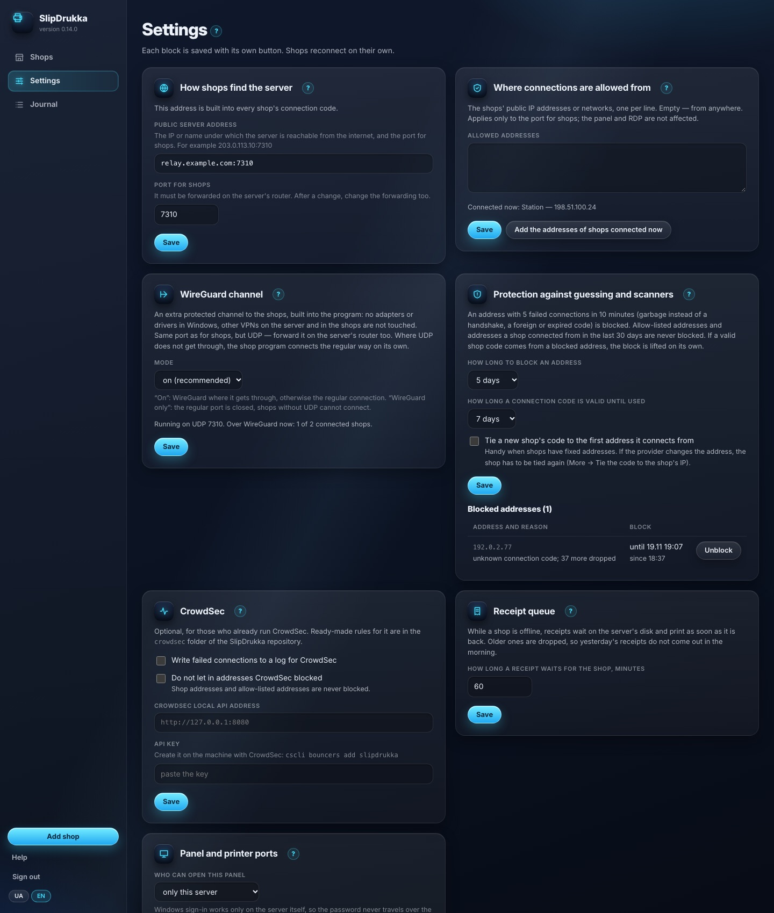

# Settings

[Українська](../uk/settings.md) · [All pages](../README.md)

Each block is saved with its own button. Connected shops stay connected or
reconnect on their own.

## How shops find the server

* **Public server address** — the IP or name under which the server is
  reachable from the internet, plus the port for shops, for example
  `relay.example.com:7310`. It is built into every **new** connection code.
* **Port for shops** — where shops connect (7310 by default). Forward it on
  the server's router: TCP, and UDP too if WireGuard is on.

**Example.** The provider gave the server a new static address. Enter it →
"Save". Connected shops stay connected, but old codes hold the old address:
if the old one stops working, issue new codes to the shops.

## Where connections are allowed from

A list of the shops' public addresses or networks, one per line, for example
`198.51.100.24` or `203.0.113.0/24`. **Empty — from anywhere.** It applies
only to the port for shops; the panel and RDP are not affected.

* Under the field you see which addresses shops are connected from now.
* "Add the addresses of shops connected now" puts them into the list.
* A list that would cut off shops connected now is not saved without
  confirmation: the panel names who would be disconnected.
* **Refused** — addresses that knocked but are not on the list. "Allow" adds
  one with a single click. Handy when a shop's address has changed.

**Example.** All three shops have static addresses. "Add the addresses of
shops connected now" → "Save". The server's port now ignores everyone but
these three.

### Narrow the firewall rule (tip)

The list above is checked by the program itself. Windows Firewall still lets
anyone reach it: the service runs without administrator rights and cannot
change the firewall (on purpose, so that a compromised program cannot
reconfigure the server's network). For the firewall to turn strangers away,
a tip under the list gives a ready command. The administrator runs it in
**PowerShell as administrator**:

* the command narrows both program rules (`SlipDrukka Server`, TCP, and
  `SlipDrukka Server WireGuard`, UDP) to the shops port and to the addresses
  set in this list, in the shops, and those shops have connected from;
* the panel shows the state: "Firewall narrowed", or which shop addresses
  are not in the rule yet; then run the command again;
* an upgrade keeps the narrowed rule (since 0.16.0);
* "Undo" is a command that opens the rule to any port and address again.

The firewall will not let a shop in from any other address. If a shop has a
dynamic address, add the new one and run the command again, or leave the
rule as it is. If the panel is open to the network, it needs a rule of its
own once this one is narrowed.

## WireGuard channel

An extra protected channel to the shops, built into the program. No adapter
or driver appears in Windows, and other VPNs on the server or in the shops
are not touched. Same port number as for shops, but **UDP**.

Inside the tunnel runs the same encrypted connection with the shop's code, so
WireGuard is one more layer of protection. The server does not answer packets
without a valid key at all, so the port stays silent to scanners.

| Mode | What happens |
|---|---|
| on (recommended) | the shop tries WireGuard; if UDP does not get through in ~10 s it connects the regular way and checks WireGuard again every 30 minutes |
| off | regular TLS connection only |
| WireGuard only | the regular port is closed; shops where UDP does not get through cannot connect |

"WireGuard only" is unavailable while the server does not know some shop's
key: the shop must connect at least once with version 0.10 or newer, or get a
new code. Under the selector you see how many shops use WireGuard now.

**Example.** WireGuard is on and UDP 7310 is forwarded on the server's
router. A minute later the shops' badge changes from "TCP" to "WireGuard". At
the shop whose provider blocks UDP it stays "TCP" — printing works as before.

## Protection against guessing and scanners

An address with **5 failed connections** in 10 minutes (garbage instead of a
handshake, a foreign or expired code) is blocked.

* **Never blocked:** addresses on the allow-list, addresses a shop's code is
  tied to, and addresses a shop connected from in the last 30 days. An old
  program version in a shop does not count as a failure either.
* The server does not answer a blocked address at all. But if a **valid**
  shop code comes from it, the block is lifted on its own: a shop that had an
  old code and has just been given a new one does not stand idle for days.
* **How long to block:** 1 hour, 1 day, 5 days (default), 30 days or forever.
* **How long a connection code is valid until used:** 1 day, 7 days
  (default), 30 days or no limit. Once a shop has connected, its code does not
  expire.
* **Tie a new shop's code to its first address** — after the first
  connection the code works only from that address. Good for static
  addresses; if the provider changes the address, the shop has to be tied
  again.
* **Blocked addresses** — a table: address, reason, connections dropped since,
  until when. "Unblock" lifts it at once.

**Example.** Someone scans port 7310 from `192.0.2.77`. After five attempts
the address appears under "Blocked" for 5 days and the server journal gets a
line about it. Nothing to do.

## CrowdSec

Optional, for servers that already run CrowdSec. Two independent switches:

* **Write failed connections to a log for CrowdSec** — `crowdsec.log` in the
  server's settings folder, one line per counted failed connection. CrowdSec
  reads it with the ready-made rules from the repository's
  [`crowdsec`](../../crowdsec/README.md) folder and blocks addresses itself.
  Shop addresses are never written there.
* **Do not let in addresses CrowdSec blocked** — every 10 seconds SlipDrukka
  pulls the list of blocked addresses and ranges from the CrowdSec Local API
  and does not let them in. It needs the API address
  (`http://127.0.0.1:8080` by default) and a key from
  `cscli bouncers add slipdrukka`. The key is never shown back. Shops and
  allow-listed addresses still get through.

Under the fields you see the last sync and how many addresses are blocked,
or an error such as "CrowdSec did not accept the API key".

**Example.** The server already runs CrowdSec with the community blocklist.
Turn on "Do not let in addresses CrowdSec blocked", paste the key — and the
port for shops ignores the addresses on the community blocklist right away.

## Receipt queue

While a shop is offline, receipts wait on the server's disk and print as soon
as it is back. **Older than this they are dropped**, so yesterday's receipts
do not come out in the morning. 60 minutes by default, from 1 minute to
7 days.

**Example.** A shop is open until 9 pm and its internet often drops for half
an hour. Keep 60 minutes: the day's receipts get through, and receipts
printed after closing do not come out next morning.

## Panel and printer ports

* **Who can open this panel** — only this server (default) or the whole local
  network. Windows sign-in still works only on the server itself; from the
  network only with the emergency password.
* **Panel port** — 7330 by default. After a change the panel reopens at the
  new address.
* **First port number for new printers** — 9101 by default. Each shop
  printer gets its own port `127.0.0.1:number` on the server.

The new port is opened first and only then the old one closed; if the port
is busy, nothing changes.
