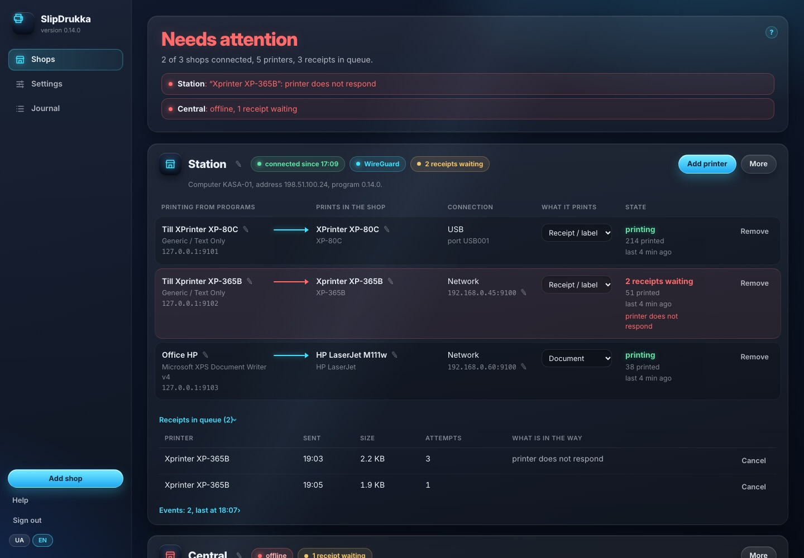

# Shops

[Українська](../uk/shops.md) · [All pages](../README.md)

## What it is for

The main window. At the top, one sentence about the state of all printing;
below it, a card for each shop with its printers. The panel refreshes itself
every few seconds.

## Status at the top

* **All printing** («Усе друкує», green) — all shops connected, the queue is
  empty or moving.
* **Needs attention** («Потрібна увага») — a list of what is wrong. The shop
  name in each line links to its card. What goes there:
  * a shop is offline, and how many receipts wait for it;
  * a printer does not print, and why (the error text from the shop);
  * receipts are waiting for a printer;
  * a printer is shared but has no [printer on the server](server-printer.md)
    yet;
  * a connection code expired before the shop ever connected;
  * a shop connected **from a new address**. Such a line has two buttons:
    "OK" (you changed the provider or the computer) and "Allow only from …"
    (the shop's code will work only from that address from now on).
* Under the heading — a summary: shops connected, printers, receipts queued.

## A shop card

**Header:** the name (✎ renames), state badges and buttons.

| Badge | Meaning |
|---|---|
| green "connected since 08:12" | the shop program has been connected since then |
| cyan "WireGuard" | the connection runs through the built-in WireGuard tunnel |
| grey "TCP" | a regular encrypted TLS connection (UDP does not get through at the shop, or WireGuard is off) |
| amber "2 receipts waiting" | that many receipts sit on the server for this shop |
| red "offline" | the shop is not connected now; receipts wait |

**Add printer** — [share another printer](add-printer.md) of the shop
(shown only while the shop is connected).

**More:**

* **Issue a new connection code** — the old code stops working at once, the
  shop disconnects until the new one is entered there. For when the code
  leaked or the shop computer was replaced.
* **Tie the code to the shop's IP** — the shop's code works only from the
  given addresses. Empty — from anywhere.
* **Delete shop** — its printers stop printing, queued receipts are
  cancelled.

**Line under the header:** computer name, address, program version, which
addresses the code is tied to, and until when an unused code is valid.

### Network

The **Network** button on a shop card shows where the shop is:

* **public address** — the one the shop connected from (as the server sees
  it), and those it connected from before;
* **addresses in the shop network** and the **router** — reported by the
  shop program (behind NAT a shop cannot know its own public address, so the
  server tells it);
* the **address the shop connects to** and where it leads;
* **response time** over the connection in the last hour (measured every
  30 s) with a graph, so you can see when it lagged;
* **trace** on a button, both ways: from the server to the shop and from the
  shop to the server. Takes up to a minute.

None of this asks an outside service. Needs shop program 0.17.0 or newer.

## The printers table

Each row is the path of one printer: **where programs print → where it
comes out**.

| Column | Contents |
|---|---|
| Printing from programs | the Windows printer on the server that programs choose (✎ renames), its driver and port `127.0.0.1:91xx` |
| arrow | state colour: cyan — printing, dashed amber — receipts waiting, red — error, dashed — no printer on the server yet |
| Prints in the shop | the Windows printer in the shop (✎ renames it in the shop) and its driver |
| Connection | USB (port `USB001`…) or network (`192.168.0.45:9100`, ✎ changes the IP) |
| What it prints | **Receipt / label** or **Document** (see below) |
| State | what is going on and how much was printed |
| action | "Remove" or "Free the port" |

### States

| State | Meaning | What to do |
|---|---|---|
| printing / ready | all fine | nothing |
| N receipts waiting | the printer did not take a receipt, the server retries | check the printer in the shop: paper, power, cable |
| not printing | the printer is missing from the shop's Windows (Document mode) | bring the printer back or share another one |
| no printer on the server | programs have nothing to print to yet | [create a printer on the server](server-printer.md) |
| shop offline | receipts wait | see the shop page, the shop's internet |
| not shared | the printer was removed but its port is kept | "Free the port" if it is no longer needed |

### Receipt / label or Document

* **Receipt / label** — the receipt is rendered by the model driver **on the
  server**, the shop gets the ready bytes unchanged. "Generic / Text Only" is
  enough in the shop. For receipt and label printers (Xprinter, Zebra,
  Gprinter).
* **Document** — the server uses the built-in "Microsoft XPS Document Writer
  v4", the shop gets a document, and **the printer's own driver in the shop**
  prints it. For printers that need their own driver on site (some laser
  printers). Paper size and orientation are set in the print dialog as usual.

The mode is switched right in the row.

### Remove and free the port

* **Remove** — the server stops printing to this printer. The printer itself
  stays in the shop. Its `91xx` port stays reserved, so if it is shared
  again, the queues on the server keep working.
* **Free the port** (in a "not shared" row) — the port goes to new printers.
  Receipts waiting for it are cancelled.

## Under the table

* **Receipts in queue** — each waiting receipt: which printer, when sent,
  size, attempts so far and what is in the way. "Cancel" — it will not print.
* **Events** — what the shop program noticed on its own: a printer renamed,
  a new driver, a printer gone or back.

## Example

The label printer at the "Station" shop ran out of paper.

1. The top says "Needs attention: Station — «Xprinter XP-365B»: the printer
   does not respond".
2. In that printer's row the arrow is red, the state "2 receipts waiting".
3. The clerk loads paper. Within seconds the server delivers both receipts,
   the row turns cyan, and the top says "All printing" again.

Nothing to press: the server retries on its own.
