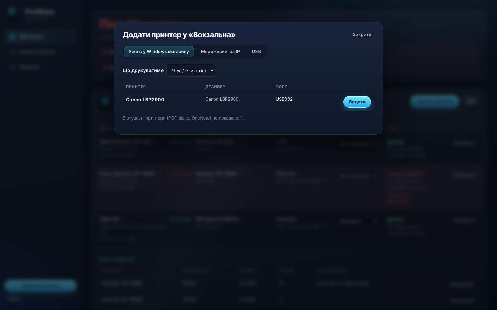
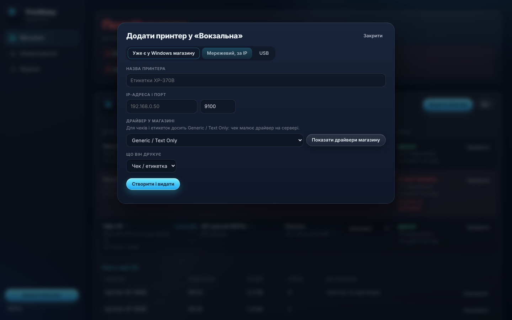
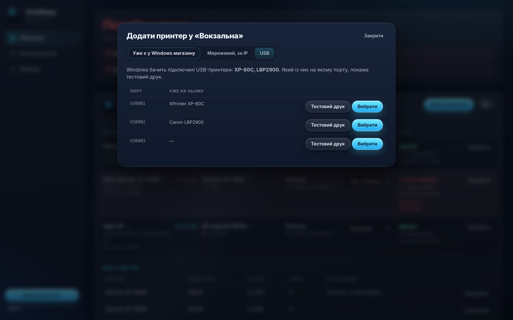

# Додати принтер

[English](../en/add-printer.md) · [Усі сторінки](../README.md)

## Для чого

Видає серверу принтер магазину. Кнопка «Додати принтер» є в картці
магазину, коли він на зв'язку. Усе виконує сама програма в магазині — їхати
туди чи заходити на той комп'ютер не треба.

Після «Видати» або «Створити і видати» панель одразу відкриває
[Принтер на сервері](server-printer.md): без нього програмам на сервері
нікуди друкувати.

У кожній вкладці є вибір **«Що друкуватиме»**: «Чек / етикетка» чи
«Документ» (різницю пояснено на сторінці [Магазини](shops.md#чек--етикетка-чи-документ)).

## Вкладка «Уже є у Windows магазину»

Список принтерів Windows у магазині, які ще не видано. Віртуальні (PDF,
факс, OneNote) сховано — їх кількість написано під таблицею. Колонки:
назва, драйвер (з позначкою v4, якщо це драйвер нового типу), порт.

**Приклад.** У павільйоні вже стоїть Canon LBP2900 на USB002. Вибираєте
«Документ» (Canon потрібен свій драйвер) → «Видати».

## Вкладка «Мережевий, за IP»

Створює в магазині порт Standard TCP/IP і принтер Windows на ньому.

* **Назва принтера** — як він називатиметься у Windows магазину.
* **IP-адреса і порт** — адреса принтера в локальній мережі магазину,
  порт зазвичай 9100. Адресу в інтернеті програма в магазині відхилить.
* **Драйвер у магазині** — для чеків і етикеток досить «Generic / Text
  Only». «Показати драйвери магазину» підтягне список драйверів, які вже
  встановлено на тому комп'ютері.

**Приклад.** Етикетковий Xprinter XP-370B стоїть у мережі магазину на
`192.168.0.50`. Назва «Етикетки XP-370B», адреса `192.168.0.50`, порт
`9100`, драйвер «Generic / Text Only», «Чек / етикетка» → «Створити і
видати».

## Вкладка «USB»

Список USB-портів принтерів (`USB001`, `USB002`…) і що вже на кожному
стоїть. Якщо Windows знає моделі підключених принтерів, вони написані
вгорі.

* **Тестовий друк** — друкує на цей порт короткий текст, щоб у магазині
  побачили, який принтер на якому порту.
* **Вибрати** — відкриває форму: назва і що друкуватиме. Принтер буде
  створено з драйвером «Generic / Text Only».

**Приклад.** До каси підключили новий чековий принтер, але невідомо, на
якому він порту. «Тестовий друк» біля USB003 — продавець каже, що надрукував
чековий. «Вибрати» біля USB003 → назва «Чек каса 2» → «Створити і видати».

## Що програма в магазині дозволяє серверу

* Перейменувати, змінити драйвер чи IP-адресу можна лише в принтера, якого
  видано серверу або якого створила сама програма. Інших принтерів магазину
  сервер не чіпає.
* Адреса мережевого принтера — лише з локальної мережі (10.x, 172.16–31.x,
  192.168.x або локальне ім'я).
* Один магазин може видати до 64 принтерів.
