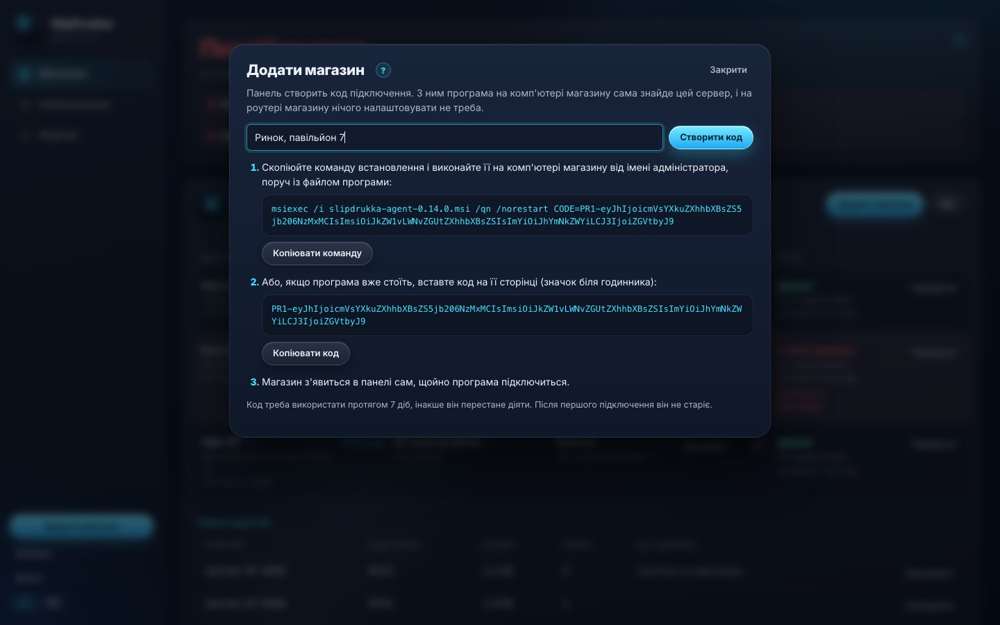

# Додати магазин

[English](../en/add-shop.md) · [Усі сторінки](../README.md)

## Для чого

Створює новий магазин і **код підключення** для нього. Код — це все, що
потрібно програмі в магазині, щоб знайти сервер і довести, що це саме цей
магазин.

## Як це працює

1. Введіть назву (як магазин називатиметься в панелі) і натисніть
   «Створити код».
2. Панель покаже два варіанти:
   * **команду встановлення** — `msiexec … CODE=SD1-…`. Виконайте її на
     комп'ютері магазину від імені адміністратора, у теці з файлом
     `slipdrukka-agent-X.Y.Z.msi`. Програма встановиться і одразу
     підключиться;
   * **сам код** — якщо програма в магазині вже стоїть (наприклад, магазин
     переїхав на новий сервер), вставте код на її сторінці.
3. Щойно програма підключиться, магазин з'явиться в панелі «на зв'язку».

Що в коді: адреса сервера, випадковий ключ саме цього магазину, відбиток
сертифіката сервера (щоб магазин не підключився до підробленого сервера) і,
якщо увімкнено, ключ WireGuard сервера. Сервер зберігає лише хеш ключа.

**Код діє один раз.** Під час першого підключення програма магазину отримує
від сервера власний довгостроковий ключ і зберігає його у своїй захищеній
теці даних; відтоді сам код сервер відхиляє. Код, що лишився в чаті, на
флешці чи в журналі встановлення, після цього нічого не дає. Щоб
перевстановити програму магазину або перенести її на інший комп'ютер,
видайте новий код: «Ще → Видати новий код підключення».

Програма магазину, старша за 0.18.0, власний ключ узяти не вміє і далі
користується кодом; оновіть її, щоб цей захист запрацював.

**Термін дії.** Код треба використати протягом терміну з
[Налаштувань](settings.md#захист-від-підбору-і-сканерів) (за замовчуванням
7 днів).

## Приклад

Відкривається новий магазин «Ринок, павільйон 7».

1. «Додати магазин» → «Ринок, павільйон 7» → «Створити код» →
   «Копіювати команду».
2. На комп'ютері павільйону (по віддаленому доступу) відкриваєте командний
   рядок від адміністратора в теці з інсталятором і вставляєте команду.
3. За кілька секунд у панелі — картка «Ринок-павільйон-7» із зеленою
   позначкою «на зв'язку». Далі — [додати принтер](add-printer.md).

## Якщо не підключається

* Перевірте в [Налаштуваннях](settings.md), що зовнішня адреса правильна і
  порт прокинуто на роутері сервера.
* На сторінці магазину (`http://127.0.0.1:7320`) видно причину, наприклад
  «не вдалося підключитися до relay.example.com:7310».
* «Код підключення протермінований» — видайте новий: «Ще → Видати новий код».
