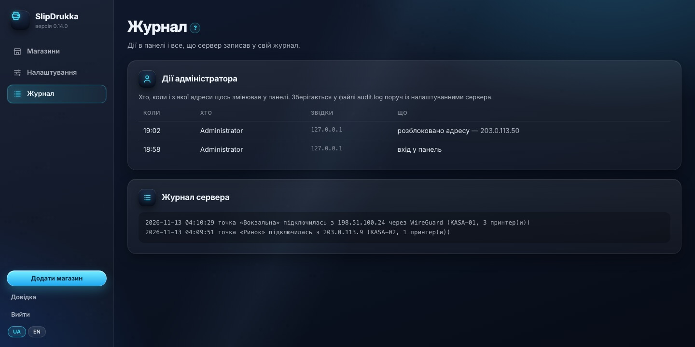

# Журнал

[English](../en/journal.md) · [Усі сторінки](../README.md)



## Дії адміністратора

Хто, коли і з якої адреси щось змінював у панелі: входи (і невдалі спроби),
додані й видалені магазини, нові коди, зміни списків адрес, портів,
WireGuard і захисту, розблокування, перейменування, скасовані чеки. Новіші
згори.

Зберігається у файлі `audit.log` у теці налаштувань сервера
(`%ProgramData%\SlipDrukka\server`), по рядку JSON на дію. Коли файл
перевищує 1 МБ, він переноситься в `audit.log.1` і починається новий.
Панель показує останні 100 записів.

**Приклад.** Магазин раптом відключився. У журналі дій видно: «07:42 —
Administrator, 127.0.0.1 — видано новий код точки — Вокзальна». Отже,
хтось видав магазину новий код, і його треба вставити на тому комп'ютері.

## Журнал сервера

Технічний журнал: підключення й відключення магазинів (і яким каналом),
доставлені чеки, відхилені й заблоковані адреси, помилки. Новіші згори.
Повний файл — `server.log` у тій самій теці.

**Приклад рядків:**

```
точка «Вокзальна» підключилась з 198.51.100.24:41000 через WireGuard (KASA-01, 3 принтер(и))
друк Вокзальна/kasa1 → «XPrinter XP-80C»: 812 байт надруковано (завдання 6ioRD3An89jX, у черзі 1s)
адресу 192.0.2.77 заблоковано до 18.11 03:37: 5 невдалих підключень за 10 хв (невідомий код підключення)
```
