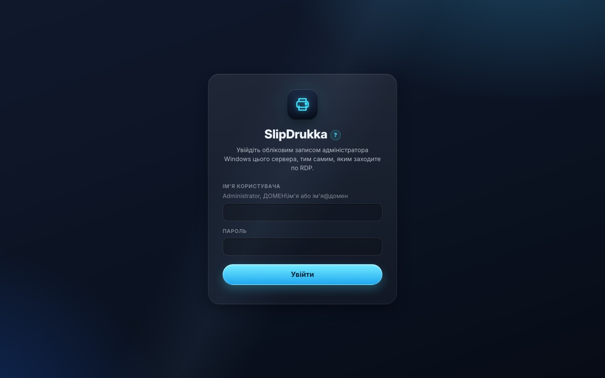

# Вхід

[English](../en/login.md) · [Усі сторінки](../README.md)

## Для чого

Панель сервера закрита паролем. Входять обліковим записом **адміністратора
Windows цього сервера** — тим самим, яким заходите по RDP. Окремих
користувачів SlipDrukka немає.

## Як це працює

* **Ім'я:** `Administrator`, `ДОМЕН\ім'я` або `ім'я@домен`.
* Вхід обліковим записом Windows приймається **лише на самому сервері**
  (`127.0.0.1`), щоб пароль не йшов мережею. Якщо в налаштуваннях панель
  відкрита для локальної мережі, з іншого комп'ютера вхід Windows не пройде.
* **Аварійний пароль** — на випадок, коли вхід Windows недоступний. Його
  задає команда `slipdrukka-server.exe set-password` на сервері. Щоб увійти
  ним, залиште ім'я порожнім. Підказка під кнопкою з'являється, лише коли
  такий пароль задано.
* **Захист від підбору:** 5 невдалих спроб за 5 хвилин блокують вхід на
  хвилину, кожне наступне блокування вдвічі довше (до 15 хвилин). Спроби
  рахуються окремо для кожного сеансу Windows, тож один користувач
  термінального сервера не заблокує інших.
* Кожен вхід і кожна невдала спроба записуються в [Журнал](journal.md) —
  хто, коли і звідки.

## Приклад

Ви зайшли на сервер по RDP як `Administrator`, відкрили
`http://127.0.0.1:7330`, ввели те саме ім'я й пароль — панель відкрилась.
У журналі дій з'явився рядок «вхід у панель — Administrator, 127.0.0.1».

## Якщо не пускає

* **«Вхід обліковим записом Windows — лише на самому сервері»** — ви
  відкрили панель з іншого комп'ютера. Відкрийте її на сервері або увійдіть
  аварійним паролем.
* **«Забагато невдалих спроб — зачекайте N с»** — зачекайте вказаний час.
* Обліковий запис не адміністратор — увійдіть адміністратором або додайте
  запис у групу «Адміністратори».
