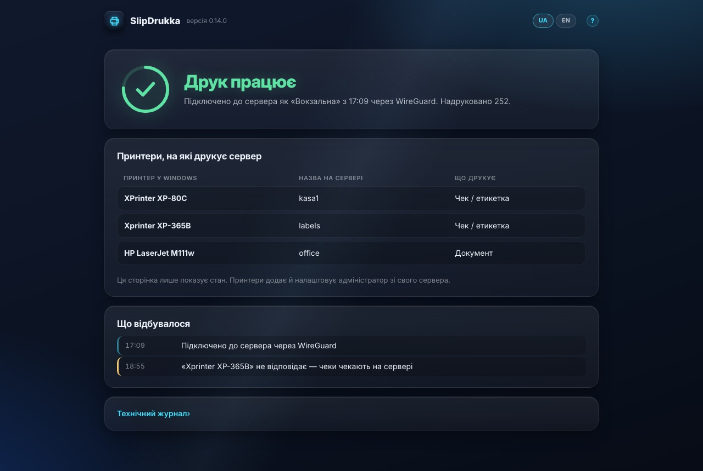

# Сторінка магазину

[English](../en/point.md) · [Усі сторінки](../README.md)

## Для чого

Сторінка програми на комп'ютері магазину. Відкривається там же:
`http://127.0.0.1:7320` або значок біля годинника → «Відкрити панель».
**Лише показує стан**: керування — з панелі сервера. Пароля немає, бо
змінити тут нічого не можна.

## Що на ній

* **Кільце стану:**
  * зелене з галочкою, **«Друк працює»** — підключено до сервера; під
    заголовком: як магазин називається на сервері, з якого часу, через
    WireGuard чи ні, скільки надруковано;
  * червоне з хрестиком, **«Немає зв'язку з сервером»** — програма сама
    підключиться, щойно з'явиться інтернет; чеки тим часом чекають на
    сервері. Під заголовком — причина;
  * сіре, **«Магазин ще не підключено»** — немає коду.
* **Підключення до сервера** — поле для коду. З'являється лише для нового
  магазину або коли сервер відхилив старий код (магазин видалили чи видали
  новий код). Робочий магазин звідси на інший сервер не переключити.
* **Принтери, на які друкує сервер** — принтер Windows, як він називається
  на сервері, і що друкує.
* **Що відбувалося** — що програма помітила сама: принтер перейменовано,
  змінився драйвер, принтер не відповідає, зник чи повернувся.
* **Технічний журнал** — для підтримки.

## Програма в магазині працює сама

Кожні 15 секунд вона звіряє видані принтери з Windows:

* Windows Update поставив інший драйвер і змінив назву принтера — якщо на
  тому самому порту рівно один такий принтер, програма сама переходить на
  нього;
* у принтера драйвер нового типу (v4), а він друкує чеки — програма друкує
  через службову чергу «SlipDrukka (назва)» з драйвером «Generic / Text
  Only» на тому ж порту. Сам принтер не чіпається;
* принтер зник — так само через службову чергу на запам'ятованому порту;
* коли принтер знову придатний, службова черга прибирається сама.

Усе це видно в «Що відбувалося» і в панелі сервера.

## Приклад

Продавчиня каже, що «щось не друкує». Відкриваєте на касі значок біля
годинника: червоне кільце, «Немає зв'язку з сервером. Причина: не вдалося
підключитися до relay.example.com:7310». Значить, в магазині немає
інтернету — чеки чекають на сервері й вийдуть самі, щойно він з'явиться.
