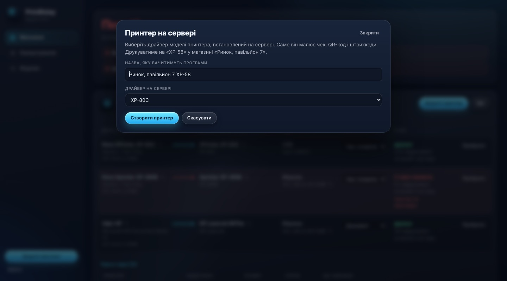

# Принтер на сервері

[English](../en/server-printer.md) · [Усі сторінки](../README.md)

## Для чого

Програми на сервері (облік, каса) друкують на звичайні принтери Windows.
Цей діалог створює на сервері такий принтер для кожного принтера магазину.
Відкривається сам після додавання принтера або кнопкою «Створити принтер на
сервері» в рядку таблиці.

## Як це працює

* **Назва, яку бачитимуть програми** — саме її касир вибиратиме в діалозі
  друку. Зручно починати з назви магазину: «Вокзальна Чек», «Вокзальна
  Етикетки».
* **Драйвер на сервері:**
  * для «Чек / етикетка» — драйвер **моделі** принтера (XP-80C, ZDesigner…).
    Саме він малює чек, QR-код і штрихкоди, тому його треба заздалегідь
    встановити на сервері. Список показує драйвери, які вже є на сервері;
  * для «Документ» — підставляється вбудований «Microsoft XPS Document
    Writer v4», нічого ставити не треба.
* «Створити принтер» — на сервері з'являється порт `SLIPDRUKKA_91xx`
  (`127.0.0.1:91xx`) і принтер Windows на ньому.

Порт `91xx` закріплений за принтером магазину: навіть якщо принтер
прибрати й видати знову, номер той самий, і черги на сервері не ламаються.

На один принтер магазину можна створити кілька принтерів на сервері з різними
драйверами — вони всі друкують на той самий принтер у магазині.

**Безпека:** порти `127.0.0.1:91xx` приймають дані лише від диспетчера друку
Windows. Програма, яка спробує надіслати дані в порт напряму, оминаючи
принтер Windows, отримає відмову. Хто може друкувати, визначають дозволи
самого принтера Windows на сервері.

## Приклад

У павільйоні видано чековий XP-58.

1. Відкривається «Принтер на сервері», назва вже заповнена:
   «Ринок, павільйон 7 XP-58».
2. Драйвер на сервері — «XP-58» (його поставили на сервер раніше).
3. «Створити принтер». У програмі на сервері касир вибирає принтер
   «Ринок, павільйон 7 XP-58» — і чек виходить у павільйоні.

## Зауваження

* ✎ біля назви — перейменувати принтер на сервері. Програми запам'ятовують
  принтер за назвою, тож після перейменування його треба вибрати в них
  заново.
* Драйвер моделі для чеків ставить адміністратор сервера, як і раніше:
  програма драйверів не завантажує.
