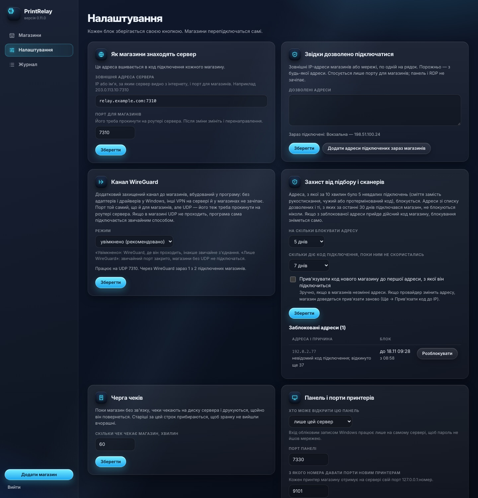

# Налаштування

[English](../en/settings.md) · [Усі сторінки](../README.md)

Кожен блок зберігається своєю кнопкою. Підключені магазини лишаються на
зв'язку або перепідключаються самі.

## Як магазини знаходять сервер

* **Зовнішня адреса сервера** — IP або ім'я, за яким сервер видно з
  інтернету, і порт для магазинів, наприклад `relay.example.com:7310`. Ця
  адреса вшивається в кожен **новий** код підключення.
* **Порт для магазинів** — на нього підключаються магазини (за
  замовчуванням 7310). Його треба прокинути на роутері сервера: TCP, і ще
  UDP, якщо увімкнено WireGuard.

**Приклад.** Провайдер дав серверу нову статичну адресу. Впишіть нову
адресу → «Зберегти». Уже підключені магазини не відключаться, але старі коди
містять стару адресу: якщо стара перестане працювати, видайте магазинам нові
коди.

## Звідки дозволено підключатися

Список зовнішніх адрес або мереж магазинів, по одній на рядок, наприклад
`198.51.100.24` або `203.0.113.0/24`. **Порожньо — з будь-якої адреси.**
Стосується лише порту для магазинів; панелі та RDP не зачіпає.

* Під полем видно, з яких адрес магазини підключені зараз.
* «Додати адреси підключених зараз магазинів» — вписує їх у список.
* Список, який відключив би підключені зараз магазини, без підтвердження не
  збережеться: панель назве, кого саме відключить.
* **«Кого не пустили»** — адреси, які стукали, але їх немає в списку. Кнопка
  «Дозволити» додає адресу одним натиском. Зручно, коли магазину змінили
  адресу.

**Приклад.** Усі три магазини мають статичні адреси. «Додати адреси
підключених зараз магазинів» → «Зберегти». Тепер порт сервера ігнорує всіх,
крім цих трьох.

## Канал WireGuard

Додатковий захищений канал до магазинів, вбудований у програму. У Windows не
з'являється ні адаптера, ні драйвера, інші VPN на сервері й у магазинах не
зачіпаються. Порт той самий, що й для магазинів, але **UDP**.

Усередині тунелю йде те саме шифроване з'єднання з кодом магазину, тобто
WireGuard — ще один шар захисту. На пакети без правильного ключа сервер
взагалі не відповідає, тож для сканерів порт мовчить.

| Режим | Що відбувається |
|---|---|
| увімкнено (рекомендовано) | магазин пробує WireGuard; якщо UDP не проходить за ~10 с — підключається звичайним способом і перевіряє WireGuard знову кожні 30 хвилин |
| вимкнено | лише звичайне з'єднання TLS |
| лише WireGuard | звичайний порт закрито; магазини, де UDP не проходить, не підключаться |

«Лише WireGuard» недоступний, доки сервер не знає ключа якогось магазину:
магазин має хоча б раз підключитися з версією 0.10 і новішою, або отримати
новий код. Під вибором видно, скільки магазинів зараз ідуть через WireGuard.

**Приклад.** Увімкнули WireGuard і прокинули на роутері сервера UDP 7310.
За хвилину біля магазинів позначка змінилась з «TCP» на «WireGuard». У
магазині, де провайдер ріже UDP, лишилось «TCP» — друк працює як раніше.

## Захист від підбору і сканерів

Адреса, з якої за 10 хвилин було **5 невдалих підключень** (сміття замість
рукостискання, чужий або протермінований код), блокується.

* **Не блокуються ніколи:** адреси зі списку дозволених, адреси, до яких
  прив'язано код магазину, і адреси, з яких за останні 30 днів підключався
  магазин. Стара версія програми в магазині теж не вважається невдачею.
* Заблокованій адресі сервер нічого не відповідає. Але якщо з неї прийде
  **дійсний** код магазину, блокування зніметься само: магазин зі старим
  кодом, якому щойно видали новий, не простоїть дні.
* **На скільки блокувати:** 1 годину, 1 добу, 5 днів (за замовчуванням),
  30 днів або назавжди.
* **Скільки діє код підключення, поки ним не скористались:** 1 доба, 7 днів
  (за замовчуванням), 30 днів або без терміну. Після першого підключення код
  не старіє.
* **Прив'язувати код нового магазину до першої адреси** — після першого
  підключення код діятиме лише з тієї адреси. Зручно для статичних адрес;
  якщо провайдер змінить адресу, магазин доведеться прив'язати заново.
* **Заблоковані адреси** — таблиця: адреса, причина, скільки з'єднань
  відкинуто, до коли. «Розблокувати» знімає блок одразу.

**Приклад.** Хтось сканує порт 7310 з `192.0.2.77`. Після п'яти спроб адреса
з'являється в «Заблокованих» на 5 днів, а в журналі сервера — рядок про
блокування. Робити нічого не треба.

## CrowdSec

Необов'язково, для серверів, де вже стоїть CrowdSec. Дві незалежні галочки:

* **Писати невдалі підключення в журнал для CrowdSec** — файл `crowdsec.log`
  у теці налаштувань сервера, по рядку на кожне враховане невдале
  підключення. CrowdSec читає його готовими правилами з теки
  [`crowdsec`](../../crowdsec/README.md) репозиторію і блокує адреси сам.
  Адреси магазинів туди не пишуться ніколи.
* **Не пускати адреси, які заблокував CrowdSec** — SlipDrukka кожні 10 секунд
  забирає з локального API CrowdSec список заблокованих адрес і мереж і не
  пускає їх. Потрібні адреса API (за замовчуванням `http://127.0.0.1:8080`) і
  ключ із `cscli bouncers add slipdrukka`. Ключ назад не показується.
  Магазини й адреси зі списку дозволених однаково проходять.

Під полями видно останню синхронізацію і скільки адрес заблоковано, або
помилку, наприклад «CrowdSec не прийняв ключ API».

**Приклад.** На сервері вже стоїть CrowdSec зі спільним чорним списком.
Вмикаєте «Не пускати адреси, які заблокував CrowdSec», вставляєте ключ — і
порт для магазинів одразу ігнорує адреси зі спільного чорного списку.

## Черга чеків

Поки магазин без зв'язку, чеки чекають на диску сервера і друкуються, щойно
він повернеться. **Старіші за цей строк прибираються**, щоб зранку не вийшли
вчорашні. За замовчуванням 60 хвилин, можна від 1 хвилини до 7 днів.

**Приклад.** Магазин працює до 21:00, а інтернет там часто зникає на
пів години. Залиште 60 хвилин: чеки за день дійдуть, а чеки, надруковані
ввечері після закриття, вранці не вийдуть.

## Панель і порти принтерів

* **Хто може відкрити цю панель** — лише цей сервер (за замовчуванням) або
  вся локальна мережа. Вхід обліковим записом Windows однаково працює лише на
  самому сервері; з мережі — лише аварійним паролем.
* **Порт панелі** — за замовчуванням 7330. Після зміни панель сама
  відкриється за новою адресою.
* **З якого номера давати порти новим принтерам** — за замовчуванням 9101.
  Кожен принтер магазину отримує на сервері свій порт `127.0.0.1:номер`.

Новий порт спершу відкривається, і лише тоді закривається старий; якщо порт
зайнятий, нічого не зміниться.
