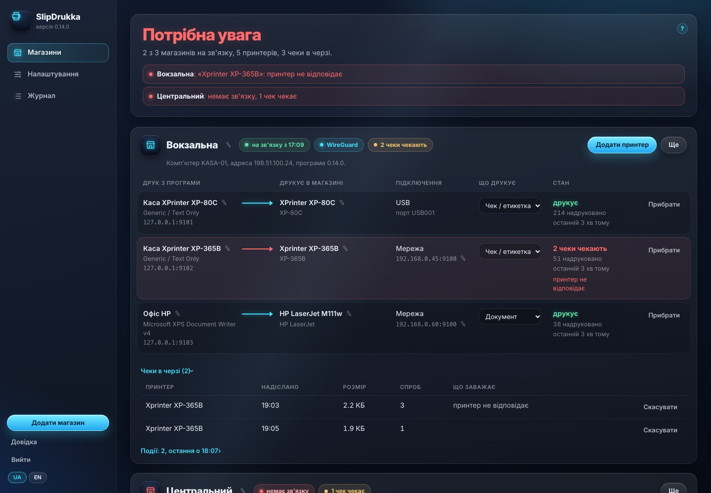

# Магазини

[English](../en/shops.md) · [Усі сторінки](../README.md)

## Для чого

Головне вікно. Зверху — одне речення про стан усього друку, нижче — картка
на кожен магазин із його принтерами. Панель оновлюється сама кожні кілька
секунд.

## Стан угорі

* **«Усе друкує»** (зелене) — усі магазини на зв'язку, черга порожня або
  рухається.
* **«Потрібна увага»** — під заголовком список того, що не так. Назва
  магазину в рядку — посилання на його картку. Що туди потрапляє:
  * магазин без зв'язку і скільки чеків на нього чекає;
  * принтер не друкує, і чому (текст помилки з магазину);
  * чеки чекають на принтер;
  * принтер видано, але для нього ще не створено
    [принтер на сервері](server-printer.md);
  * код підключення протермінувався, а магазин так і не підключився;
  * магазин підключився **з нової адреси**. Біля такого рядка дві кнопки:
    «Зрозуміло» (це ви змінили провайдера чи комп'ютер) і «Дозволити лише з
    …» (код магазину надалі діятиме тільки з цієї адреси).
* Під заголовком — підсумок: скільки магазинів на зв'язку, скільки принтерів,
  скільки чеків у черзі.

## Картка магазину

**Заголовок:** назва (✎ — перейменувати), позначки стану і кнопки.

| Позначка | Що означає |
|---|---|
| зелена «на зв'язку з 08:12» | програма в магазині підключена з цього часу |
| бірюзова «WireGuard» | з'єднання йде через вбудований тунель WireGuard |
| сіра «TCP» | звичайне шифроване з'єднання TLS (UDP у магазині не проходить або WireGuard вимкнено) |
| жовта «2 чеки чекають» | стільки чеків лежить на сервері для цього магазину |
| червона «немає зв'язку» | магазин зараз не підключений; чеки чекають |

**«Додати принтер»** — [видати ще один принтер](add-printer.md) магазину
(кнопка є, лише коли магазин на зв'язку).

**«Ще»:**

* **Видати новий код підключення** — старий код одразу перестає діяти,
  магазин відключається, доки на ньому не вставлять новий. Для випадку, коли
  код потрапив у чужі руки або комп'ютер магазину замінили.
* **Прив'язати код до IP магазину** — код цього магазину діятиме лише з
  указаних адрес. Порожньо — з будь-якої.
* **Видалити магазин** — принтери перестануть друкувати, чеки в черзі буде
  скасовано.

**Рядок під заголовком:** ім'я комп'ютера, адреса, версія програми, до яких
адрес прив'язано код, і до коли діє ще не використаний код.

## Таблиця принтерів

Кожен рядок — шлях одного принтера: **звідки друкують → куди друкується**.

| Колонка | Що в ній |
|---|---|
| Друк з програми | принтер Windows на сервері, який вибирають програми (✎ — перейменувати), його драйвер і порт `127.0.0.1:91xx` |
| стрілка | колір стану: бірюзова — друкує, жовта пунктирна — чеки чекають, червона — помилка, пунктир — ще немає принтера на сервері |
| Друкує в магазині | принтер Windows у магазині (✎ — перейменувати його в магазині) і його драйвер |
| Підключення | USB (порт `USB001`…) або мережа (`192.168.0.45:9100`, ✎ — змінити IP) |
| Що друкує | **Чек / етикетка** або **Документ** (див. нижче) |
| Стан | що з ним зараз і скільки надруковано |
| дія | «Прибрати» або «Звільнити порт» |

### Стани

| Стан | Що означає | Що робити |
|---|---|---|
| друкує / готовий | усе гаразд | нічого |
| N чеків чекають | принтер не прийняв чек, сервер повторює | глянути принтер у магазині: папір, живлення, кабель |
| не друкує | принтера немає у Windows магазину (для режиму «Документ») | повернути принтер у магазині або видати інший |
| немає принтера на сервері | програми ще не мають куди друкувати | [створити принтер на сервері](server-printer.md) |
| магазин не на зв'язку | чеки чекають | див. сторінку магазину, інтернет у магазині |
| не видано | принтер прибрали, але порт закріплено за ним | «Звільнити порт», якщо він більше не потрібен |

### Чек / етикетка чи Документ

* **Чек / етикетка** — чек малює драйвер моделі **на сервері**, у магазин
  ідуть готові байти без змін. У магазині досить драйвера «Generic / Text
  Only». Для чекових і етикеткових принтерів (Xprinter, Zebra, Gprinter).
* **Документ** — на сервері вбудований «Microsoft XPS Document Writer v4»,
  у магазин іде документ, і друкує його **рідний драйвер у магазині**. Для
  принтерів, яким потрібен свій драйвер на місці (частина лазерних
  принтерів). Формат паперу й орієнтація задаються як завжди в діалозі друку.

Режим перемикається прямо в рядку.

### Прибрати і звільнити порт

* **Прибрати** — сервер перестає друкувати на цей принтер. Сам принтер у
  магазині лишається. Порт `91xx` лишається закріпленим за ним, тож якщо
  видати його знову, черги на сервері не зламаються.
* **Звільнити порт** (у рядку «не видано») — порт віддається новим
  принтерам. Чеки, що чекали на нього, скасовуються.

## Під таблицею

* **Чеки в черзі** — кожен чек, що чекає: на який принтер, коли надіслано,
  розмір, скільки було спроб і що заважає. «Скасувати» — чек не
  надрукується.
* **Події** — що програма в магазині помітила сама: перейменований
  принтер, новий драйвер, принтер зник або повернувся.

## Приклад

У магазині «Вокзальна» скінчився папір в етикетковому принтері.

1. Угорі з'являється «Потрібна увага: Вокзальна — «Xprinter XP-365B»:
   принтер не відповідає».
2. У рядку цього принтера стрілка червона, стан «2 чеки чекають».
3. Продавець вставляє папір. За кілька секунд сервер доставляє обидва чеки,
   рядок стає бірюзовим, угорі знову «Усе друкує».

Нічого натискати не треба: сервер сам повторює доставку.
